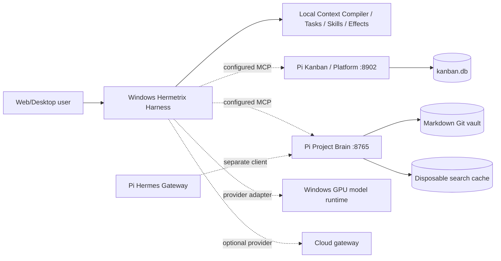

# G0 — Audit ระบบจริงและข้อเสนอ Architecture

วันที่ตรวจ: 2026-11-01, Asia/Bangkok

**สถานะ: การตรวจระบบตามขอบเขตที่เข้าถึงได้เสร็จแล้ว; พร้อมรีวิวแผนและตัดสินใจอนุมัติ G1. ยังไม่อนุมัติ Architecture หรือการแก้ Production.** การเทียบรายละเอียด Full Scope ทั้งชุดยังมีข้อจำกัด เพราะไม่พบเอกสาร 00–22. ข้อจำกัดนี้เป็นรายการส่งมอบที่ยังขาด ไม่ใช่เหตุให้หยุดตรวจระบบจริง และไม่ถือว่าข้อกำหนดที่ไม่เห็นผ่านแล้ว

Godot AI Studio ถูกพักตามคำสั่งผู้ใช้. ไม่ได้นับงานแก้เสียงเป็นการผ่าน G0 หรือเป็นการ deploy Platform

## 1. วิธีตรวจและขอบเขตความปลอดภัย

SSH ไป Pi ด้วย BatchMode และ StrictHostKeyChecking ตาม host ที่บันทึกไว้เดิม. อ่าน OS/ทรัพยากร, process metadata, systemd status, timers, crontab, listeners, Docker inventory, Git HEAD/status, source/API declarations และฐานข้อมูล SQLite ผ่าน mode=ro + query_only. ไม่ import application เพื่อหลีกเลี่ยง startup migration. ตรวจ effective credential grants จาก process environment โดยเลือกแสดงเฉพาะ scopes/projects/expiry/boolean; ไม่ส่งออก token, digest ของ token หรือค่า secrets

ทดสอบ live MCP tools/list, Platform whoami/list_platform_projects และ Brain negative project-scope read. ไม่สร้าง task/session/candidate และไม่เรียก production write API. ไม่เรียก positive Brain get_context เพราะ source ยืนยันว่า retrieval อาจสร้าง/refresh disposable SQLite cache. ไม่มี service restart, install, migration, deploy, network-policy change หรือแก้ vault

อ่านไฟล์ติดตั้ง Windows, Go build metadata, GPU/CPU/RAM, listener/process inventory และ installed SQLite โดยตรงแบบอ่านอย่างเดียว. ไม่เปิดโปรแกรมติดตั้งเพื่อหลีกเลี่ยง migration โดยไม่ตั้งใจ. การ SSH/HTTP อาจเพิ่ม access log ตามปกติ; SQLite WAL reader อาจใช้ shared-memory bookkeeping. ไม่อ้างว่า filesystem ทุก byte คงเดิม เพราะบริการอื่นทำงานอยู่ระหว่างตรวจ

## 2. Component map จากระบบจริง

| ส่วน | สิ่งที่พบจริง | เจ้าของข้อมูล/ข้อจำกัด |
|---|---|---|
| Pi | Debian 13.6 aarch64; kernel 6.18.39; RAM 15 GiB, available ประมาณ 13 GiB; NVMe root 468 GiB, available 347 GiB | ใช้ร่วมกับระบบอื่น ไม่ใช่ GPU inference worker หลัก |
| Kanban Board | user service active, /home/pizp2e0/workspace/kanban, loopback :8901 | Board/work registry, SQLite kanban.db |
| Kanban MCP | user service active, loopback :8902; live tools/list 22 tools | แยก identity และ board project ID จาก local project ID |
| Project Brain | second-brain-mcp active, /home/pizp2e0/projects/second-brain-mcp, loopback :8765; 27 live tools | Markdown/Git เป็นข้อมูลหลัก, SQLite search เป็น cache |
| Hermes Gateway | active, /home/pizp2e0/.hermes; Python 3.14.7 | เป็นอีก agent runtime ไม่ใช่ Windows Hermetrix Harness |
| Windows development | i7-12700F 12 cores/20 threads; RAM 68,523,835,392 bytes; RTX 5070 Ti 16,303 MiB VRAM | GPU used 1,863 MiB ณ snapshot; ไม่ใช่ measured inference capacity |
| Windows installed app | %LOCALAPPDATA%/Hermetrix/hermetrix.exe และ data/hermetrix.db | ณ snapshot ไม่พบ process Hermetrix/llama-server/whisper-server/ollama; app/model ports ไม่เปิด |

เส้นประคือมี config/source integration ไม่ใช่หลักฐานว่าปลายทางทำงานครบวงจรบน installed app ณ เวลาตรวจ

## 3. Version / deployment baseline

| รายการ | เวอร์ชันหรือหลักฐาน |
|---|---|
| Harness checkout | dev HEAD b3de3a8; มี uncommitted voice fixes และงานทดสอบ/เอกสารเดิม ต้องแยกจาก commit baseline |
| Kanban checkout | 3fa0e0c0599e078a65d728e60cdd7f4ac0768741; process start 2026-10-10 |
| Brain checkout | 2730d21176293097a4fe7dbd6c2eb7cad7a1ecfc; process start 2026-10-22 |
| Hermes checkout | 18c525b669b6ea4ba62e6967d228af21d89aa9d3 |
| Vault Git HEAD | 01059dab0df3decbb7b038edb2fc9256daf2d760 |
| Pi Python / Node | Python 3.13.5 / Node v22.23.2; Hermes uses its own Python |
| Brain venv metadata | mcp 1.30.0, jsonschema 4.26.0, rfc8785 0.1.4 |
| Windows toolchain | Go 1.26.4 windows/amd64; Node v20.18.1; NVIDIA driver 610.88 |
| Installed executable | SHA256 bcef8a23ef33c0fcb6d29ed6cfddfb8a590516b547e7d4f0a3d7036d20c33750; built Go 1.26.4; no VCS revision in build metadata |
| Installed DB / current source | installed PRAGMA user_version=50; source CurrentSchemaVersion=82. ห้ามอนุมานว่า installed app เท่ากับ current checkout |

Source on disk และ process start ตรวจได้ แต่ Python process ไม่เก็บ immutable loaded-source SHA ให้พิสูจน์ทุก module; entry-file mtime เก่ากว่า process start สอดคล้องกันแต่ไม่ใช่ release attestation. Installed binary hash ยืนยันตัวไฟล์ได้ แต่ระบุ source commit ไม่ได้

## 4. Interface inventory

**Kanban MCP 22 tools, live discovery:** list_projects, list_platform_projects, list_tasks, get_brief, get_roadmap, get_calendar, whoami, list_capabilities, get_node, get_agent, add_task, update_task, complete_task, delete_task, add_project, update_project, delete_project, update_task_ai, list_subtasks, add_subtask, complete_subtask, delete_subtask. มีทั้ง read/write แต่ G0 ใช้ read เท่านั้น

**Brain MCP 27 tools, live discovery:** search, get_context, get_context_multi, save_session, resume_session, list_sessions, refresh_search_index, read_passage, read_page, list_pages, index, get_schema, history, capture, record_lesson, submit_knowledge_candidate, list_pending_knowledge_candidates, read_pending_knowledge_candidate, prepare_knowledge_candidate_review, review_knowledge_candidate, record_use, ingest, promote, update_page, set_frontmatter, rebuild_index, append_log. การโฆษณาเครื่องมือไม่ได้แปลว่าผู้เรียกมีสิทธิ์หรือ write path ผ่าน acceptance

**Ingress ที่อ่านจาก tunnel config:** secondbrain → localhost:8765; kanban → :8901; agent-knowledge และ agent-platform → :8902; registry → :5000. Platform connector อ่าน identity/project grants ผ่าน HTTPS ได้จริง. Brain unauthorized scope ถูกปฏิเสธผ่าน connector จริง

**Harness source integration:** cmd/hermetrix/main.go ผูก read-only retriever เข้าทั้ง Chat และ Task coordinator; candidate submission ใช้ server/identity แยก. internal/projectbrain/retrieval.go ตรวจ configured server, scope และ version-bound evidence. internal/agentplatform/service.go เป็น fixture-only managed adapter มี guard ห้าม task run/effect. จึงห้ามนับ package นี้เป็น production managed dispatch

**Installed MCP records:** Platform tools=22, Brain read profile tools=25, Brain submit profile tools=27, protocol saved=2025-11-25. Saved status ready เป็น historical DB field ไม่ใช่ live health. Brain read profile จำนวนน้อยกว่า live discovery ต้อง refresh/เทียบ schema บน isolated copy ก่อนใช้จริง

## 5. ข้อมูลและสิทธิ์ที่ใช้งานจริง

- Board migration table ล่าสุด v10; PRAGMA user_version=0 ไม่ใช่หลักฐานว่าไม่มี migration. มี 5 workspaces, 6 platform projects, 6 board projects, 30 tasks, 3 nodes, 3 agents, 5 credentials. platform_services=0 และ task_repo_scopes=0: registry มีอยู่ แต่ยังไม่พิสูจน์ scoped remote execution
- Live Platform whoami: scoped_agent codex-windows/windows-pc-main; read + work.write; expiry ที่ API คืนเป็น 2026-11-07 16:34:06 โดยไม่มี timezone. มี Hermetrix platform project key hermetrix-harness, id=3, workspace=agent-platform. ตรวจ read เท่านั้นแม้ credential มี write
- Brain process config: legacy token absent, legacy override off, anonymous public read off. hermetrix-bonsai และ hermes-pi มี read เฉพาะ hermetrix-harness; submit actor มี candidate_submit; curator แยก actor. Codex Windows มี read/write เฉพาะ project ดังกล่าว. มี client อื่นที่ grant กว้างกว่าโดยตั้งค่าไว้; ไม่ใช่เหตุให้ลด grant ใน G0
- Negative read ไป project g0-audit-ungranted ถูกปฏิเสธว่า credential lacks read access to requested scope. พิสูจน์กรณีนี้เท่านั้น ไม่ใช่ exhaustive authorization test
- Brain client grants ส่วนใหญ่หมดอายุ 2026-12-22T19:30:19Z; submit grant 2026-12-23T04:14:13Z. ต้องมี rotation plan โดยไม่พิมพ์ token
- Vault 114 Markdown files; cache 111 documents/retrieval_files; cache schema_meta=1. เฉพาะ hermetrix-harness พบ active=6, draft=44 จาก frontmatter. Active ไม่เท่ากับ verified/ready: ไม่ได้ตรวจ sources/confidence ของทุกหน้า. Session DB มีจริง user_version=1, snapshots=19, requests=19
- Installed Windows DB: 4 projects, 4 agent sessions, 2 durable tasks (completed 1/paused 1), 0 skills, 0 teams, 0 maintenance schedules. ตัวเลขเป็นข้อมูลใน data directory ของ installed launcher เท่านั้น ไม่เหมารวม pilot directories

## 6. Operations / hardware readiness

Pi ไม่มี failed system/user units ณ snapshot. Docker ps สำเร็จ: remote-workspace control API, guacd, postgres, redis และ registry; 4 ตัวแรกมี healthy status. มี cron daily_routine และ timers Brain backup, Hermes restart, network maintenance. Brain backup service ล่าสุด Result=success / exit=0 เวลา 23:00:05 แต่ยังไม่เท่ากับ restore drill ผ่าน. ไม่รัน restore หรือแก้ cron

Kanban มี tracked edits daily_routine.py/kanban_brief.py และ untracked database backup; Brain มี untracked environment backups; vault มี search cache modifications และ session-state directory เดิม. ตรวจซ้ำแล้วสถานะ source เหล่านี้ยังอยู่ ไม่ reset/clean

Windows disk free: C ประมาณ 42 GiB, D ประมาณ 121 GiB. รองรับการทดลอง GPU worker แต่ 16 GB VRAM ต้องวัดตาม model/context/concurrency จริง. Installed local provider ตั้ง 16k context แบบ declared; cloud provider 128k แบบ declared. ไม่มี live model จึงไม่อ้าง 64k qualification จากการตรวจครั้งนี้. ไม่บังคับย้าย inference ไป Pi

Installed launcher บังคับรอ Bonsai :8088 ก่อนเปิดแอป แม้ DB มี cloud provider ด้วย. เป็น startup coupling ที่ควรแยก. การไม่พบ process ณ snapshot คือ offline state ไม่ใช่หลักฐาน crash. ไม่เปิด runtime อัตโนมัติใน G0

## 7. Gap เทียบกับคำขอของผู้ใช้

| ความต้องการ | สิ่งที่มี | ช่องว่างที่จะทำต่อ |
|---|---|---|
| ChatGPT-like workspace | Chat/project/workspace UI, provider/context/tools ใน source | installed/source drift; end-to-end UX/loading/error/recovery และเสียงต้อง qualified |
| Agent / Skills / MCP | มี runtime, versioned Skills, approval/effects, MCP adapters | installed Skills=0; contract freshness, realistic task outcome และ negative tests |
| Multi-Agent | Source/team schema มี | installed teams=0; concurrency/cancel/budget/evidence ต้องพิสูจน์บน worker จริง |
| Automation | maintenance scheduling source และ Pi cron/timers | ยังไม่ใช่ general user automation ที่ผ่าน restart/missed-run/dedup/cancellation acceptance |
| Hermetrix + Brain เดิม | แยก read/submit config, live Brain/Platform | managed adapter ยัง fixture-only; version freshness, evidence admission และ task ownership mapping |
| Local LLM / GPU Worker | RTX 5070 Ti, provider records และ local tooling | runtime ปิด; measured model/context/latency/concurrency และ worker isolation ยังไม่มีผลยืนยันรอบนี้ |
| Secure/maintainable/modular | ขอบเขต ownership, narrow adapters, schemas/test packages | release provenance, restore drill, migration 50→82, Windows isolation และ credential rotation |
| Godot | ไม่ตรวจเพื่อรับรองความพร้อม | deferred ทั้งหมด |

## 8. Architecture decision options

A — **แนะนำให้อนุมัติ:** รักษา Harness เป็น execution/context authority, Pi Platform เป็น registry/work tracking, Brain เป็น curated knowledge owner; เพิ่ม optional versioned adapters และ GPU worker boundary. ไม่สร้าง orchestration อีกชุดซ้ำโดยไม่มีเหตุผล

B — เพิ่ม gateway/service ใหม่ข้างระบบเดิมเมื่อวัดแล้วพบความจำเป็นด้าน routing/identity. ขณะนี้เพิ่ม operational surface โดยยังไม่มีหลักฐานต้องใช้

C — รวมฐานข้อมูล/แทนที่ระบบเดิม. เสี่ยงที่สุดต่อ legacy, security และ migration; ไม่แนะนำจากหลักฐานปัจจุบัน

รายละเอียดงาน Dependency/Risk/Acceptance/Rollback อยู่ใน [G0-IMPLEMENTATION-PLAN.md](G0-IMPLEMENTATION-PLAN.md). ADR เป็น proposed เท่านั้น

## 9. ข้อจำกัดและสถานะอนุมัติ

อ่าน README และ 23 Full Scope ตามลำดับแล้ว; ค้น Downloads และ D:/Projects ไม่พบ 00-CODEX-MASTER-PROMPT หรือสเปก 01–22. จึงจัด traceability จากเป้าหมายที่ผู้ใช้พิมพ์และสองไฟล์ที่มี โดยไม่แต่งรายละเอียดในเอกสารที่หาย. ไม่สามารถเซ็นรับรอง Full Scope รายข้อที่ไม่ได้รับ

ไม่มี positive live retrieval ที่เสี่ยงเขียน cache, ไม่มี inference/cloud cost probe, ไม่มี production write test/restore/migration และไม่มีการเปิด Windows runtime. งานเหล่านี้เป็น acceptance ใน isolated staging หลังอนุมัติ ไม่ใช่ผลผ่านของ G0. ไม่อ้าง compatibility หรือคุณภาพผลลัพธ์ที่ยังไม่ได้วัด

**สิ่งที่ขออนุมัติครั้งถัดไป:** Architecture A และ G1 ในแผนเท่านั้น. การแก้ production, credential rotation, schema upgrade, restart/deploy ต้องขออนุมัติแยกพร้อมผล staging และ rollback ที่ทดสอบแล้ว. G0 ไม่ได้ให้สิทธิ์เริ่ม G1 โดยอัตโนมัติ
