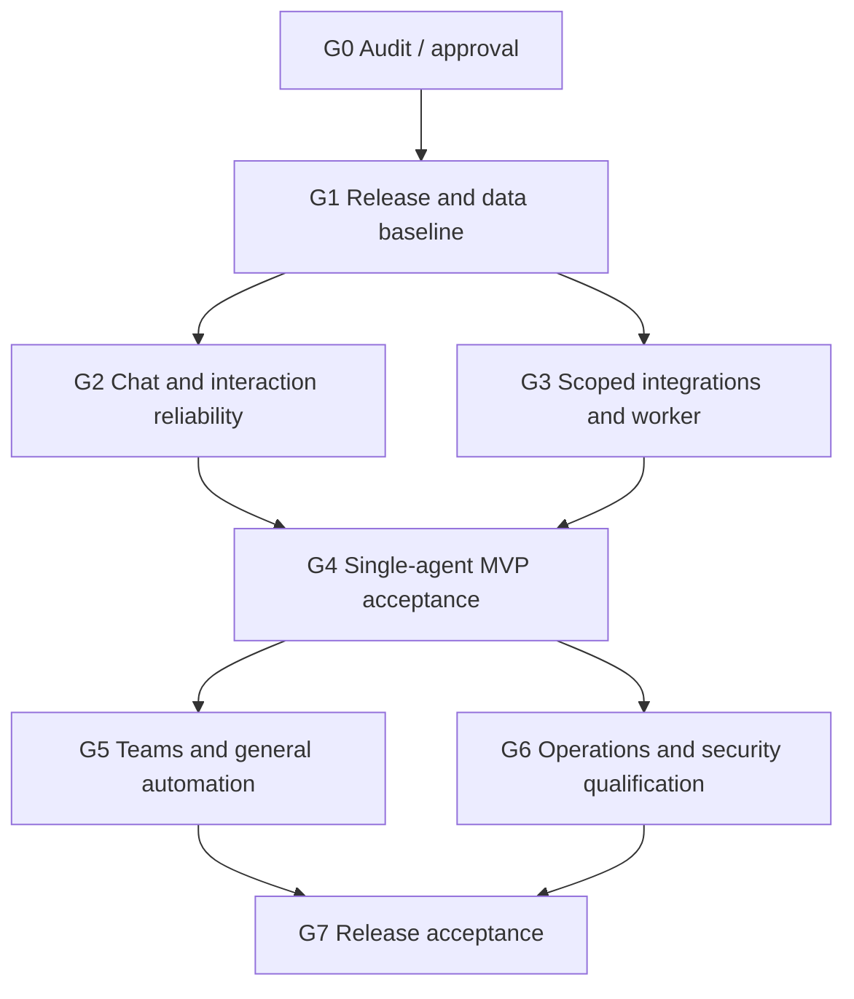

# Hermetrix AI Platform — Implementation Plan หลัง G0

วันที่: 2026-11-01 · สถานะ: **อนุมัติให้พัฒนา G1–G7 ใน development/staging แล้ว; ผลตรวจแต่ละ gate ดู PLATFORM-RELEASE-STATUS.json** · Godot deferred

ฐานหลักฐาน: [AUDIT-REPORT.md](AUDIT-REPORT.md). แผนนี้อิงระบบที่ตรวจจริง ไม่ใช่การรับรองสเปก 00–22 ที่ยังไม่ได้รับ. ลำดับ G1–G7 ด้านล่างเป็นข้อเสนอสำหรับ Platform เท่านั้น ต้อง reconcile กับต้นฉบับเมื่อได้เอกสารเพิ่ม

## เป้าหมายและขอบเขต

ให้ผู้ใช้เลือก project → สนทนา → ใช้บริบท/เครื่องมือ → มอบหมายงาน → เห็นผลและหลักฐาน → หยุด/กู้คืนได้ โดยไม่ทำลายระบบเดิม. ใช้ Go Harness และ SQLite เดิม, Pi Platform/Brain เดิม และ GPU PC ที่มี. ไม่เพิ่มฐานข้อมูลหรือ message broker ใหม่จนกว่าจะมีภาระงานที่พิสูจน์ว่าต้องใช้

Production owner ยังคงถือสิทธิ์ deploy/credential/schema/network. ทุก gate มี reviewable diff, acceptance receipt และ rollback ก่อนนำเสนอ production approval. ค่าเวลา/งบ model จะกำหนดจาก baseline G1 ไม่เดาจากขนาด GPU

## Dependency graph

G1–G4 เป็น MVP. เริ่ม gate ใหม่เมื่อ dependency และ acceptance ก่อนหน้าผ่าน. Gate labels ไม่ถือเป็นการอนุมัติอัตโนมัติ และไม่จำเป็นต้องสร้าง service ใหม่หนึ่งตัวต่อ gate

## G1 — Release provenance และ staging baseline

**ปัญหา:** installed DB=50, current source=82; installed binary ไม่มี VCS revision; app/LLM offline; working tree มีงานค้าง

งานที่เสนอ:

1. แยก committed baseline, voice changes, local tests/Lab/docs ให้เป็นชุด review. ไม่ reset งานค้างและไม่รวม test artifacts เข้า commit ตามคำสั่งเดิม
2. เพิ่ม release manifest: source commit + dirty-tree identity, executable SHA, schema range, toolchain และ startup flags ที่ไม่มี secrets
3. เตรียม isolated development/staging data directory. ก่อนใช้ข้อมูลจริงต้องตกลงว่าจะใช้ fixture หรือสำเนาที่ปกปิดข้อมูล; ไม่คัดลอก vault/credentials อัตโนมัติ
4. ตรวจ migration 50→82 บนสำเนาที่ได้รับอนุญาต: schema, row relationships, paused task, session history และ foreign-key/integrity checks
5. แยก startup UI จากการบังคับ Local LLM พร้อมแสดง provider unavailable อย่างตรงไปตรงมา. ออกแบบ launcher dry-check ที่ไม่เปิด store/migrate

Dependencies: อนุมัติ Architecture A/G1; source baseline; approved staging directory/data handling; ไม่ต้องใช้ production credential ใหม่เพื่อทำ fixture tests

Acceptance: manifest ระบุ binary/source/schema ได้; staging DB ผ่าน integrity_check/foreign_key_check และ invariants ของข้อมูลก่อน/หลัง; migrate ซ้ำไม่เปลี่ยนผล; โปรแกรมเก่าและข้อมูลเดิมไม่ถูกแตะ; offline provider ไม่ทำให้ launcher คลุมเครือ; credential values ไม่อยู่ใน logs/artifacts

Rollback: หยุดเฉพาะ staging process; เลิกใช้ staging directory; revert เฉพาะ G1 commits. ไม่ downgrade production DB. เก็บ backup ก่อน migration และพิสูจน์การ restore เป็น data-directory คนละชุด; ห้ามคัดลอกไฟล์ DB เดี่ยวขณะ WAL writer ทำงาน

## G2 — Chat / workspace / voice reliability

งาน: project/session identity ชัดเจน; loading/empty/error/retry/cancel; ไม่ส่งคำสั่งซ้ำเมื่อไม่ทราบผล; ตรวจต่อเนื่องกับเสียงที่แก้ใน development แล้ว. รูปแบบ UI ยึดของเดิม ปรับจาก user workflow ไม่เริ่ม redesign ใหม่ทั้งระบบ

Dependencies: G1; model profile ใน isolated runtime; fixture สำหรับเสียงและ browser

Acceptance:

- เลือก project A/B แล้วไฟล์/ประวัติ/เครื่องมือไม่ข้าม project; refresh/restart กลับงานเดิมถูกต้อง
- ส่งคำขอครั้งเดียวได้หนึ่ง committed user turn; lost response ไม่สร้างงานซ้ำ; stop/cancel มีสถานะจริง
- เสียงเงียบ, click, late/duplicate final ไม่เพิ่มข้อความ; Thai/English fixture และ full-duplex speaker echo ต้องมีผลทดสอบจริงแยกจาก controller tests
- keyboard/focus และ viewport 390/768/1440 ไม่ทำปุ่มส่ง/หยุดหาย; screenshots และ browser error capture ครบ

Rollback: revert UI/server event contract เป็นคู่; reset เฉพาะ staging client state เมื่อจำเป็น; ไม่ลบประวัติ. ไม่อ้างว่า voice fixes ปัจจุบันผ่าน acoustic acceptance แล้ว

## G3 — Brain / Platform adapters และ GPU worker boundary

งาน: ทำ identity mapping ให้ชัด (local project, Platform Project, board project, Brain project); refresh metadata บน staging; ตรวจ exact versions และ egress filtering; ออกแบบ bounded worker job/result/cancel/health interface และ session-independent leases. แยก fixture-only managed adapter ออกจาก production feature flags. ไม่เปลี่ยน internal Agent Platform guards เพื่อให้ test ดูผ่าน

Dependencies: G1; reviewed interface schemas; least-privilege staging grants ถ้าต้องใช้ live fixture; model runtime ที่ owner อนุญาตให้เปิด; network allowlist ของ worker

Acceptance:

- Brain read/write-submit/curator เป็นคนละสิทธิ์; wrong project/version/expired grant และ malformed response ถูกปฏิเสธ
- positive retrieval ต้องทดสอบบน vault/cache ที่แยกไว้ก่อน; ตรวจ passage version/source/line range และ candidate ไม่เข้า active retrieval ก่อน curator อนุมัติ
- Worker รับงานที่มี immutable scope เท่านั้น; cancel/restart/timeout ไม่สร้าง effect ซ้ำ; uncertain result ถูกพักและ reconcile
- ทดลอง local model จริงเพื่อวัด context allocation, peak VRAM, latency, Thai/code quality และ concurrency; รายงาน declared/probed/qualified แยกกัน
- Pi services เดิมยังทำงานและไม่มีการบังคับ inference หนักบน Pi

Rollback: disable optional adapters/worker admission; revoke เฉพาะ staging grants ที่สร้างภายหลังได้รับอนุมัติ; ปล่อย active operations จบหรือบันทึก uncertain ก่อนหยุด; ไม่ลบ Brain knowledge หรือ registry เดิม

## G4 — Single-agent Platform MVP

งาน: ใช้ Task engine/coordinator เดิมให้ครบ requirement → plan → scoped file selection → proposal → approval → apply → checks → independent review → completion. ทดสอบ Skills version freezing, learning outbox, source guards และ evidence receipts กับงานขนาดเล็กจริง

Dependencies: G2 + G3; approved writable dev workspace; writer/reviewer profile; fixed acceptance task corpus

Acceptance: งานแก้โค้ดอย่างน้อยหนึ่งงานสำเร็จครบวงจรและงานล้มเหลวอย่างน้อยหนึ่งงานย้อนกลับได้; stale preimage/permission denial/uncertain provider/restart ไม่ข้าม approval; หลักฐานทุกผลผูก exact revision; token/time/tool budget บังคับจริง; learning สร้าง candidate เท่านั้น. Reviewer คนละ profile ไม่ถือว่าเป็นคนละ model หาก endpoint/model เดียวกัน

Rollback: disable goal dispatch; preserve receipts; restore files ด้วย preimage guards และหยุดเมื่อพบ user edit conflict; ไม่ auto-reset repository

## G5 — Multi-Agent และ general Automation

งาน: ใช้ Team roster/DAG เดิม, child session contracts, aggregate budgets; เพิ่ม user-facing schedule/event trigger เมื่อจำเป็น พร้อม timezone Asia/Bangkok, missed-run policy, dedup key, enable/disable และ cancellation. ไม่เหมารวม maintenance timer ว่าเป็น automation สำเร็จรูป

Dependencies: G4; measured GPU capacity; approved scheduling policy

Acceptance: dependent tasks ไม่เริ่มก่อน prerequisites; child permission ไม่กว้างกว่าที่ให้; cancellation ถึงลูกทุกตัว; restart ไม่ยิง schedule ซ้ำ; budget รวมไม่เกิน; ไม่มี overlapping runs ที่ไม่ได้อนุญาต; automation หยุดได้และแจ้ง meaningful failure. ทดสอบ client disconnect และ uncertain effects

Rollback: pause schedules/admission ก่อน, cancel/reconcile in-flight runs, disable new routes; retain schedules/history เพื่อเปิดกลับได้ ไม่ลบ state

## G6 — Operational/security qualification

งาน: threat model จาก data flow, Windows process isolation gap, least-privilege worker, backups/restore, credential expiry/rotation, release manifests, metrics/log redaction และ runbooks. แก้ production credential/config ได้เฉพาะ approval แยก

Dependencies: G4; G5 ถ้า release มี automation; restore target แยก; operator handoff

Acceptance: unauthorized project/global reads และ privilege widening fail closed; no secrets in logs; restore drill ใช้งานข้อมูลได้จริง; rotation ไม่ fallback เป็น legacy shared token; process cleanup และ network/filesystem boundaries มีผลทดสอบตาม OS. สถานะ backup success อย่างเดียวไม่ผ่าน restore acceptance

Rollback: retain previous secret references ใน secure operator-controlled window ถ้านโยบายอนุญาต; restore config ที่ backup หลัง approval; ไม่เก็บ token ใน Git; ถ้า revoke แล้วให้ issue ใหม่ ไม่คืน token ที่ถูกเพิกถอน

## G7 — Release และ rollout

งาน: reproducible package, API/event schema docs, installation/upgrade/runbooks, browser + service integration acceptance, measured performance report และ release checklist. G7 เป็น Platform release ไม่มี Godot

Dependencies: G1–G6 ที่อยู่ใน release ผ่าน; missing-spec differences ได้รับการตัดสินใจ; owner เห็น exact diff/build hash/data migration plan

Acceptance: ติดตั้งใหม่บน isolated target, upgrade จาก baseline copy, restart/recovery และ rollback drill ผ่าน; critical user journeys ผ่านกับ runtime จริง; ไม่มี high-severity unresolved security/data-loss issue; known limitations เปิดเผย. Owner อนุมัติ production switch แยก

Rollback: หยุดรับงานใหม่, จัดการ in-flight/uncertain effects, สลับ executable/config ที่มี manifest; ถ้า schema เปลี่ยนใช้ pre-upgrade backup ที่พิสูจน์ restore แล้วพร้อมนโยบายจัดการข้อมูลใหม่ ไม่ downgrade schema โดยเดา. Health fail หลัง deploy ให้หยุด rollout ไม่ retry deploy วน

## Risk register

| ID / ระดับ | ความเสี่ยงจากหลักฐาน | มาตรการ / gate |
|---|---|---|
| R1 สูง | schema 50→82 + binary provenance ไม่ทราบ | isolated migration/restore + manifest, G1 |
| R2 สูง | production source มี operator edits | ห้าม reset/overwrite; reviewed path/commit baseline ทุกครั้ง |
| R3 สูง | fixture-only adapter ถูกเข้าใจเป็น managed execution | feature boundary + separate contracts/acceptance, G3 |
| R4 สูง | Windows process lifecycle ไม่ใช่ filesystem/network isolation | restricted worker policy และ OS acceptance ก่อนเปิด untrusted code, G3/G6 |
| R5 สูง | shared Pi มีระบบอื่นและ vault/cache ที่เปลี่ยนอยู่ | no production tests/writes ใน G0; independent rollout/rollback |
| R6 กลาง | Platform credential ใกล้ expiry 2026-11-07; Brain เดือนธันวาคม | operator rotation plan; ใช้ expiry เป็น fail-closed condition ไม่ fallback |
| R7 กลาง | 16GB GPU และ provider context เป็น declared | วัด allocation/VRAM/concurrency ก่อนกำหนดขนาดงาน |
| R8 กลาง | stale MCP tool catalog / offline installed app | isolated discovery/contract comparison และ startup checks |
| R9 กลาง | missing Full Scope 00–22 | traceability เฉพาะสิ่งที่ได้รับ; ต้อง reconcile ก่อน scope/release sign-off |
| R10 กลาง | voice acoustic issue ยังไม่ reproducible | แยก controller regression จาก noise/echo fixture acceptance |

## สิ่งที่จะเปลี่ยนก่อน หากอนุมัติ G1

- release/build manifest และตัวอ่าน version/schema แบบไม่เปิด application store
- launcher/startup diagnostics เพื่อลด dependency กับ Local LLM
- isolated migration/restore verification และ acceptance receipts
- เอกสาร baseline/ownership/rollback ที่อ้าง artifact จริง

ยังไม่เปลี่ยน Pi code, live vault, database, systemd, cron, tunnel, credentials หรือ network policy. ไม่เพิ่ม gateway ใหม่. ไม่เริ่ม G2–G7 โดยข้าม review gate

## Evidence ปัจจุบันของ G0

2026-11-01: scoped development tests ผ่านสำหรับ internal/agentplatform, piidentity, projectbrain, context, mcp และ qualification. Fixture package ไม่มี tests. Optional live tests ที่ skip ไม่ถือว่าผ่าน live integration. Live Platform identity/project read ผ่าน; live Brain wrong-project read ปฏิเสธถูกต้อง; tools/list พบ 22/27 ตามรายงาน. ไม่อ้างว่า production write, backup restore, cloud/model inference หรือ full E2E ผ่านใน G0

การอนุมัติที่ต้องการ: **Architecture A + G1 เฉพาะ development/staging**. หลังทำ G1 ส่งผลจริงและ diff ให้ review ก่อนตัดสินใจขั้นถัดไป

