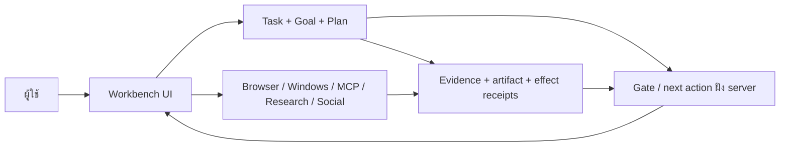

# แผนแก้ไข Hermetrix Goal-Driven Adaptive Workbench UX v2 ฉบับรวม

วันที่: 2026-09-26

สถานะ: **ผู้ใช้อนุมัติให้ลงมือแล้ว; กำลังทำตามช่วงงาน**

ขอบเขต: สเปก v2 ทั้งหมดที่ผู้ใช้ส่งมา และ [ข้อกำหนดเพิ่มเรื่องเครื่อง/วิดีโอ/คอนเทนต์](2026-09-26-goal-driven-workbench-v2-extension-plan.md)
หลักฐานตั้งต้น: ตรวจ source และ browser flow บางส่วนแล้ว; [บันทึกตรวจจริงและสถานะส่งมอบ](2026-09-26-goal-driven-workbench-v2-implementation-audit.md) แยกสิ่งที่ทำได้ออกจากส่วนที่ยังไม่พร้อม

## 1. ผลลัพธ์ที่ต้องได้

Hermetrix ต้องพาผู้ใช้จาก **เป้าหมาย → คำถามที่จำเป็น → แผน → ลงมือ → ตรวจหลักฐาน → ตรวจทาน → ผลลัพธ์** ใน Task เดียว ผู้ใช้เห็นสถานะ เจ้าของงาน สิ่งที่ติดขัด และการกระทำถัดไปโดยไม่ต้องอ่าน log ดิบ พร้อมงานเพิ่มดังนี้:

- เห็นหน้าจอและควบคุมแอป Windows กับ browser; ให้ผู้ใช้ยืนยันก่อนการกระทำที่เปลี่ยนข้อมูลบนเครื่อง
- รับ เปิดเล่น และตรวจวิดีโอโดยระบุว่าส่วนใดตรวจจริง/ยังไม่ได้ตรวจ
- ค้นบทความใหม่ เก็บแหล่งอ้างอิง ตรวจข้อกล่าวอ้าง แล้วเขียน Facebook/TikTok ตามกลุ่มผู้อ่าน
- สร้างวิดีโอผ่าน Comfy MCP, เปิดดูฉบับที่ได้ และตรวจความพร้อมของไฟล์
- ให้ผู้ใช้ตรวจและอนุมัติ **แต่ละชิ้นต่อแต่ละบัญชี/ปลายทาง** ก่อนอัปโหลดหรือเผยแพร่; ตรวจผลบนแพลตฟอร์มภายหลัง

เงื่อนไขหลัก: ไม่มี `Done` ที่ไร้หลักฐาน, ไม่มีหน้าที่ตันโดยไม่บอกทางไปต่อ, และไม่มีงานที่กำลังเกิดโดยผู้ใช้มองไม่เห็น สเปกเดิมและ safety contract ที่เข้มกว่ายังคงมีผล

## 2. ขอบเขตและสิ่งที่ตรวจพบแล้ว

| ส่วน | ข้อเท็จจริงที่ตรวจจาก source/เครื่อง | ผลต่อแผน |
|---|---|---|
| Task | `internal/taskengine` มี requirement revision, plan, step, validation, run/effect และ next action; `CompleteTask` กับ `completionEligible` แยกกัน | ตรวจเงื่อนไขจริงก่อนแก้ แล้วใช้ gate ฝั่ง server ที่เป็นแหล่งเดียวสำหรับการปิด Task |
| API/UI | มี `/api/tasks/{id}/next-action`, Task/Plans UI, pane และ browser routes อยู่แล้ว | ต่อของเดิมและแก้ UX ตาม journey; ไม่สร้าง Task engine คู่ขนาน |
| Browser | มี managed browser ผ่าน CDP | ใช้ต่อสำหรับ browser; ผูก action กับ observation ล่าสุดและ approval ที่ตรงรายการ |
| Windows | ยังไม่พบ native desktop control adapter ใน source ที่ตรวจ | เพิ่ม adapter Windows แบบจำกัดสิทธิ์ แยกจาก CDP |
| Media | อัปโหลด/ตรวจภาพได้; video/audio processor ยังไม่พร้อม; artifact ทั่วไปจำกัด 16 MiB | สร้างช่อง ingest/stream วิดีโอแยกตามสเปก multimodal เดิม ไม่ขยาย JSON upload ทั่วไป |
| Comfy | Codex host ติดต่อ local Comfy MCP และเปิด ComfyUI ได้; template วิดีโอที่ลอง 2 แบบขาดโมเดล | ต้องเชื่อม **ภายใน Hermetrix** และหา workflow ที่ preflight ผ่านก่อนอ้างว่าสร้างวิดีโอได้ |
| Social | ยังไม่พบตัวเผยแพร่ Facebook/TikTok ใน source ที่ตรวจ; บัญชีมีอยู่ตามผู้ใช้ แต่ API grants ยังไม่ตรวจ | เพิ่มตัวเชื่อม official API พร้อม readiness, approval, upload state และ receipt |
| Checkout | มีการเปลี่ยนแปลงค้างอยู่จำนวนมาก; schema ที่ตรวจคือ v49 | P0 ต้องสำรวจ diff และป้องกันการทับงานเดิม; เช็ก HEAD/schema อีกครั้งก่อน migration |

รายการนี้ยังไม่ใช่ runtime audit ครบถ้วน P0 จะระบุ `confirmed / partial / absent / unknown` พร้อม source, route, ผลรัน และ test ของทุกส่วนที่จะเปลี่ยน

## 3. เส้นทางงานที่จะใช้เป็นเกณฑ์ตรวจรับ

| Journey | เส้นทางหลัก | ความล้มเหลวที่ต้องเห็นและกู้ได้ |
|---|---|---|
| J1 งานแก้ UI/โค้ด | เลือก Project → สร้าง Goal → ทบทวน flow/plan → ทำงาน → เปิด build ใน browser → ตรวจหลักฐาน → reviewer → Done | check fail, stale revision, browser test ไม่รัน, reviewer ไม่มี |
| J2 งานกำกวม | สร้าง Goal → ถามเฉพาะคำตอบที่มีผลต่อ acceptance/authority → บันทึกคำตอบเป็น revision → ทำส่วนที่ไม่ติดคำตอบต่อ | ผู้ใช้ยังไม่ตอบ, เปลี่ยนคำตอบ, แผนเก่าใช้ไม่ได้ |
| J3 effect ไม่แน่นอน | อนุมัติ exact action → dispatch → ขาดการเชื่อมต่อ/รีสตาร์ต → อ่าน receipt/สถานะปลายทาง → reconcile | ไม่ส่งซ้ำแบบเดาสุ่ม, ไม่แสดง Done, มี operation ID และทางแก้ |
| J4 ความสามารถขาด | Project ไม่มี code root หรือ MCP/reviewer/provider ไม่พร้อม → แสดงข้อกำหนดและงานที่ยังทำได้ | draft ไม่หาย, action ที่ต้องใช้ capability ถูกปิดพร้อมเหตุผล |
| J5 ควบคุมเครื่อง | เลือกหน้าต่าง → ดูภาพ/องค์ประกอบล่าสุด → เสนอ action → ยืนยันถ้าเปลี่ยนข้อมูล → ลงมือหนึ่งครั้ง → ดูผลใหม่ | หน้าต่าง/element เปลี่ยน, lock screen, ปฏิเสธ, หยุด, ผลไม่แน่นอน |
| J6 คอนเทนต์ | ระบุ brief → ค้นบทความ → เลือกแหล่ง → ตรวจ claim → เขียน 2 แพลตฟอร์ม → สร้าง/ดูวิดีโอ → อนุมัติแยกปลายทาง → อัปโหลด → ตรวจ remote status | ข้อมูลขัดกัน, โมเดล Comfy ขาด, token/scope ขาด, อัปโหลดค้าง, TikTok ได้เพียง draft |

ก่อนเขียน UI ของแต่ละ journey ให้ทำ flow `เข้า → ตัดสินใจ → กระทำ → feedback → recovery → จบ` พร้อม state loading, empty, error, denied, offline, stale, interrupted และ cancelled ทุก state ต้องมี next action, เหตุผลที่ต้องรอ หรือ terminal outcome ที่ชัดเจน

## 4. โครงสร้างที่ตั้งใจใช้

- **Task เป็นเจ้าของสถานะงาน**: Goal Contract, criteria, plan, revision, effect และ completion ไม่แยกเป็นระบบคอนเทนต์อีกชุด Content brief/media/publish เป็นข้อมูลและขั้นตอนที่ผูก Task
- **server เป็นผู้ตัดสิน**: status projection, progress, gate และ next action คำนวณจากข้อมูล authoritative; UI ใช้เพื่อแสดงและขอ action เท่านั้น
- **หลักฐานเป็นรายการอ้างอิงที่ตรวจย้อนกลับได้**: ทุก criterion ผูกวิธีตรวจ subject revision/hash ผลจริง ที่มา เวลา และ freshness; external article/DOM/Skill/Project Brain เป็นข้อมูลที่ไม่ใช่อำนาจสั่งเครื่อง
- **effect เดียวหนึ่ง identity**: action ที่เปลี่ยนเครื่อง, MCP, Comfy หรือ social มี target, parameters, revision, approval และ operation ID; เมื่อผลไม่แน่นอนต้อง reconcile ก่อน retry
- **ไฟล์สื่อมีช่องทางของตัวเอง**: stream/range, hash, metadata, job และ time-anchored evidence; ไม่ยัดวิดีโอหลายร้อย MB ผ่าน JSON หรือ prompt
- **ความลับอยู่ใน vault**: API token และบัญชีปลายทางแสดง identity/readiness แต่ไม่แสดง secret; ไม่มี credential ใน log/evidence/UI ทั่วไป

## 5. งานแต่ละช่วงและเกณฑ์ผ่าน

ลำดับ P0–P8 เป็น dependency ของการเริ่มงาน แต่ทุกช่วงต้องส่ง UI/backend/test ที่ใช้ได้จริงใน vertical slice ของตน ไม่รอทดสอบ browser จนช่วงสุดท้าย

### P0 — ตรวจความจริงและออกแบบการตรวจรับ

1. บันทึก branch/HEAD, dirty diff, schema, startup, API routes, UI และ test ปัจจุบัน; เปิดแอปจริงและทำ walkthrough ของ Task/Plans/browser/MCP/Skill/media เท่าที่มี
2. ทำตาราง `REUSE / MODIFY / NEW / DO NOT TOUCH` ราย subsystem พร้อม source path, runtime route, owner ของข้อมูล, migration impact, test ที่มี และ requirement ID
3. ทำ flow map J1–J6, acceptance criteria → plan step → check → evidence และแผนภาพ current/target ที่ติดป้ายชัด; เสนอ user flow/UI flow สำหรับงานหน้าจอ, ERD สำหรับ schema, และ API sequence สำหรับ integration โดยให้ผู้ใช้เลือกเปิดดูได้
4. ตรวจช่องโหว่ของ completion, effect uncertainty, session contract และ approval โดย test หรือการอ่านเส้นทางจริง ก่อนเลือก schema/API ใหม่

**ส่งมอบ:** baseline audit, flow/traceability map, ข้อเสนอ schema/API เท่าที่จำเป็น, test environment, ประเมินขนาดงานจากโค้ดจริง

**ผ่านเมื่อ:** ทุกข้ออ้าง current state มีหลักฐาน; ความไม่แน่ใจและงานค้างของผู้อื่นระบุชัด; มี acceptance ก่อนแก้โค้ด

### P1 — Goal, แผน, หลักฐาน และ Done ที่เชื่อถือได้

1. ขยาย Goal Contract แบบ versioned: outcome, scope, assumptions, constraints, owner, affected journey, stable criterion IDs, verification, reviewer/user acceptance policy และช่องที่ยังไม่รู้
2. ตรวจ plan coverage, dependency cycle, check feasibility และความเชื่อม Goal → step → check; plan revision และ diff ไม่ให้ approval เก่าใช้ผิด subject
3. ใช้ gate evaluator ฝั่ง server ตัวเดียวใน `CompleteTask`, state projection และ next action; แสดง `pass/fail/not run/blocked/stale/not applicable` พร้อมเหตุผลและหลักฐาน
4. เพิ่ม evidence ledger/progress ที่นับ criterion และ check จริง; unresolved effect, missing browser flow, reviewer หรือ acceptance ต้องปิด Done
5. ทำ Task detail หนึ่งเส้นทางให้สร้าง Goal, ทบทวน plan, เปิด gate, แก้ blocker และเห็นผลหลัง reload ได้จริง
6. ทำ activity/diagnostic projection ที่โยง Task/criterion/run/request ID โดยไม่บันทึก secret หรือเนื้อหาส่วนตัวลง telemetry

**ผ่านเมื่อ:** API ปฏิเสธ Done ถ้า criterion/check/effect/review/acceptance ขาดหรือ stale; Task ที่ครบจบครั้งเดียวพร้อม receipt; real browser ทำ J1/J2 ส่วนหลักและ recovery ผ่าน

### P2 — Workbench ที่ใช้ทำงานได้ต่อเนื่อง

1. จัด shell รอบ `Project → Task/Session → active work`: goal/status/owner/next action, pane ทำงาน, evidence/context
2. ให้ layout presets `Discuss / Plan / Build / Verify / Review`, ปรับ pane เองและจดจำตาม Project/view; preset ไม่เปลี่ยน Task state หรือสิทธิ์
3. ทำ loading/empty/error/offline/stale/denied/recovery ทุก pane; ป้องกัน response เก่าทับ Project/Task ใหม่; เก็บ draft/focus/scroll เมื่อสลับ pane
4. เพิ่ม command palette, responsive layout, keyboard/focus/screen-reader path และ deep link ไป criterion/evidence/agent

**ผ่านเมื่อ:** real browser เดิน Chat → Plan → Code/Diff → Browser/Test → Evidence → Chat โดยไม่เสียบริบท; desktop/จอแคบ/keyboard ผ่าน; error กลับมาทำต่อได้

### P3 — Context, Project Brain, MCP, Skill และทีม

1. Context meter แสดง capacity/reserves/usage โดยแยก `actual / estimated / unknown`; อธิบาย include/omit และหยุดเมื่อ pinned constraints เกินงบ
2. Project Brain แสดง source, scope, lifecycle, version, applicability และ `suggested` เทียบกับ `in context now`; Pi ล่มต้องไม่ทำให้ local Task ใช้ไม่ได้
3. MCP catalog บอก purpose, trust, transport, scopes, effect class, schema revision, readiness, usage/cost และทดสอบแบบ read-only หรือ exact approval
4. Skill directory, version pin, deterministic matching, trigger/exclusion, conflict/priority และเหตุผลการเลือก; candidate ไม่ถูก auto-inject
5. ทีมแสดง lead/worker/reviewer, งานที่รับ, session, activity, blocker, evidence; stall detector อาศัย signal จริงและมีทาง escalation

**ผ่านเมื่อ:** MCP/Skill/Context/Project Brain แต่ละสถานะทดสอบผ่านใน UI และ API; reviewer ที่ไม่พร้อมหรือ telemetry unknown ไม่กลายเป็น Done; child activity ไม่ปะปน

### P4 — เห็นและควบคุม Windows/browser

1. เพิ่ม Windows observation ด้วย screenshot + UI Automation element tree, window/process identity, timestamp และ observation revision; ระบุ protected/unsupported surface ตามจริง
2. เพิ่ม bounded action: target/element/action/arguments/observation binding, preview, confirmation ก่อนการเปลี่ยนข้อมูล, stop/cancel และ receipt หลัง action
3. ผูก managed browser ที่มีอยู่เข้ากับ Task/evidence/approval โดยไม่ลด browser network guard เดิม
4. เมื่อเปลี่ยนหน้าต่าง, element, lock screen, หมดอายุ observation หรือผล dispatch ไม่แน่นอน ให้ hold/reobserve/reconcile ไม่ click ซ้ำ

**ผ่านเมื่อ:** ใช้กับ Windows app อย่างน้อย 2 แบบและ browser จริง; ปฏิเสธ action, target เปลี่ยน, restart และ emergency stop มีผลตามคาด; ไม่มี mutation ที่ข้าม confirmation

### P5 — ดูวิดีโอและสร้างผ่าน Comfy MCP

1. ทำ streaming import/private artifact/player ที่ seek ได้, ตรวจ MIME/metadata/hash/limits ตาม OVL-046–055 (เริ่มที่ MP4/WebM 256 MiB, 10 นาที, <=4K, <=32 sampled frames หาก P0 ไม่พบเหตุให้ปรับ)
2. ทำ media jobs แบบ durable, cancel/restart, processor allowlist และ resource limits; frame/transcript ผูก timestamp และบอกช่วงที่ไม่ได้ตรวจ
3. เชื่อม Comfy local MCP ภายใน Hermetrix: discover, model/node/workflow preflight, job submit/status/cancel/reconcile, output capture; แยก local กับ paid/cloud route
4. ทำหน้า preview วิดีโอ, script/storyboard, metadata และความพร้อมปลายทาง; ไม่เรียกผลตรวจที่ไม่รันว่า pass

**ผ่านเมื่อ:** workflow ที่ preflight ผ่านสร้าง output จริงและเล่นใน Hermetrix หลัง refresh ได้; missing model, corrupt/oversize video, cancel และ restart แสดง recovery; ไม่มี paid run โดยไม่มีการยืนยันเฉพาะ

### P6 — ค้นบทความและทำคอนเทนต์

1. ทำ content brief ที่มี topic, language, audience, freshness, destination และ policy; ถ้าไม่ทราบให้ถามใน Task ก่อนทำชิ้นจริง
2. ค้นจากเครื่องมือ/แหล่งที่อนุมัติ บันทึก URL, publisher, published/retrieved time, source hash และความไม่แน่ใจ; เปรียบเทียบอย่างน้อย 2 แหล่งเมื่อเป็น claim สำคัญ
3. ทำ claim ledger และ fact/rights review; อ้างที่มาของข้อความแต่ละประเด็น; source content ไม่สามารถออกคำสั่ง tool หรือเปลี่ยนสิทธิ์
4. ร่าง Facebook copy และ TikTok caption/script/storyboard แยกตามรูปแบบ; ผูก revision กับแหล่งและสื่อ; edit แล้ว invalidate review/approval ที่ขึ้นกับมัน

**ผ่านเมื่อ:** เดินจากบทความจริงถึง draft ทั้งสองช่องทางพร้อมแหล่งอ้างอิง; claim ที่ขัดกัน/ไม่มีที่มาถูก flag และแก้ได้; preview แสดง exact content

### P7 — เชื่อมบัญชี อนุมัติ และเผยแพร่

1. ตรวจ readiness ของ Facebook Page และ TikTok account/app grants โดยไม่เผย token; แสดงบัญชีเป้าหมายและ capability ที่ได้รับจริง
2. ทำ approval ต่อ **content item × destination × media/copy/settings hash**; แสดง preview, visibility, account และผลที่กำลังจะเกิดก่อนอนุมัติ; edit ทำให้ approval เก่าหมดผล
3. Facebook Reels ใช้ลำดับ create/upload/finish/status ตาม API ที่รองรับ; TikTok ใช้ Direct Post เมื่อ grant ผ่าน หรือ upload draft เมื่อเป็นทางที่มี โดยแสดงว่า draft ยังไม่ใช่ published
4. เก็บ upload session, operation ID, remote ID, progress/status, receipt/link; หลัง timeout/restart อ่านสถานะเดิมก่อนตัดสินใจ retry

**ผ่านเมื่อ:** contract/negative tests กัน stale approval, wrong destination, duplicate dispatch และ unknown effect; pilot ที่ผู้ใช้อนุมัติจริงมี remote receipt/status; ไม่มีการอ้างว่า published จากเพียง HTTP upload สำเร็จ

### P8 — ตรวจปล่อยใช้งานและส่งมอบ

1. ทดสอบ migration ฐานข้อมูลเก่า, backup/restore ที่เกี่ยวข้อง, reload/restart, concurrency/revision, security/privacy และ no-replay
2. ทดสอบ J1–J6 ใน build จริง: browser desktop/compact/keyboard, Windows app, Comfy output และ social pilot ตามสิทธิ์ที่มี; เก็บ screenshot/trace/request ID
3. ทำเอกสารผู้ใช้/ผู้ดูแล, capability setup, known limitations, migration/rollback และ report ที่โยง requirement → evidence → gate
4. วัด performance บนเครื่องอ้างอิงก่อนระบุ SLO; คงสถานะ `incomplete/blocked` สำหรับ gate ที่ยังรันไม่ได้

**ผ่านเมื่อ:** ทุก MUST ที่ใช้กับ release มีหลักฐาน revision ปัจจุบันและทุก safety gate ผ่าน; หากบาง integration ยังรอ grant/model ให้ส่งสถานะจริงพร้อมขั้นตอนถัดไป ไม่อ้างว่า full v2 Done

### ตารางครอบคลุมข้อกำหนดเดิม

| Requirement IDs จากสเปกเดิม | งานหลัก | Phase ที่ตรวจรับ |
|---|---|---|
| GDW-GOAL-01/02, GDW-DISC-01, GDW-PLAN-01/02/03 | Goal Contract, คำถามจำเป็น, traceability, flow/diagram และแผนที่ทบทวนได้ | P0–P1 |
| GDW-STATE-01/02, GDW-DONE-01, GDW-PROG-01 | state/transition, completion predicate, progress จริง | P1 |
| GDW-VERIFY-01/02, GDW-FLOW-01/02 | evidence ledger, real browser, flow coverage, recovery/dead-end | P0–P2 และทวนทุก phase |
| GDW-UI-01/02/03/04 | Task shell, presets/responsive, honest states, command palette | P2 |
| GDW-BRAIN-01, GDW-CTX-01 | Project Brain applicability และ context budget | P3 |
| GDW-MCP-01/02, GDW-SKILL-01/02/03 | MCP catalog/test/usage และ Skill directory/matching/conflict | P3 |
| GDW-AGENT-01, GDW-STUCK-01, GDW-NEXT-01 | assignment/activity, stall, valid next action | P1/P3 |
| GDW-DATA-01, GDW-API-01, GDW-MIG-01 | additive data/API, compatibility และ aged DB | P0–P8 ตาม slice |
| GDW-SAFE-01, GDW-OBS-01 | authority/no-replay/privacy และ correlated observability | ทุก phase |
| GDW-DESKTOP/VIDEO/RESEARCH/CONTENT/COMFY/PUBLISH (ข้อกำหนดเพิ่ม) | Windows, media, article-to-content, Comfy และ publishing | P4–P8 |

## 6. ข้อมูล/API ที่คาดว่าจะต้องแตะ — ตัดสินหลัง P0

| กลุ่ม | แนวทาง | ข้อจำกัด |
|---|---|---|
| Goal/criterion/flow | เพิ่ม field/version หรือ projection จาก Task records ที่มี | migration เพิ่มเติมเท่าที่ขาดจริง; Task เก่าต้องอ่านได้และเห็น `Needs review` |
| Gate/next action/activity | read projection จาก event/receipt เดิมและ evaluator ฝั่ง server | ห้ามเก็บสถานะ Done ซ้ำที่ client ตัดสินเอง |
| Evidence/media/content | immutable artifact + manifest/hash; streaming endpoint และ derived time anchors | ไม่เก็บวิดีโอ/base64 ใน JSON, log หรือ prompt; source deletion invalidates dependent evidence |
| Desktop/Comfy/social | adapter แยกตาม effect/capability แต่ใช้ approval/operation/reconcile contract เดิม | ไม่สร้างสิทธิ์แฝงจากการต่อบัญชีหรือ MCP description |
| Secret/connection | ใช้ vault/credential boundary ที่มีและ readiness projection | ไม่ย้าย token ไป Project Brain หรือ client storage ที่ไม่ควรถือ secret |

ทุก table/API ใหม่ต้องมี owner, authoritative หรือ derived status, idempotency, migration, rollback และเหตุผลว่าทำไมของเดิมใช้ไม่ได้ ก่อนเขียนจริง

## 7. ชุดทดสอบและหลักฐานที่ต้องรายงาน

| Gate | หลักฐานขั้นต่ำ |
|---|---|
| G1 สถาปัตยกรรม | P0 audit พร้อม source/runtime, reuse map, flow, diagram และ criterion traceability |
| G2 ข้อมูล/API | migration ฐานเก่า, restart, stale revision, permission, deterministic projection, no duplicate effect |
| G3 ความถูกต้อง | negative Done/approval/effect/reviewer tests, security/recovery, build/vet/test ที่เกี่ยวข้อง |
| G4 UX | real browser J1–J4 และ J6: success/recovery, desktop/compact, keyboard/focus, screenshots/trace/console |
| G5 เครื่อง/สื่อ | real Windows J5, video play/seek/limits, Comfy local preflight/output/recovery |
| G6 integrations | MCP schema/trust/cost, Skill match/conflict/pin, Project Brain trust, social grants/draft/direct/remote receipt |
| G7 release | native runtime, aged data, privacy, rollback และ report ตามข้อเท็จจริง |

ทุกรายการรายงาน `PASS / FAIL / SKIPPED / NOT RUN / BLOCKED` พร้อม environment, subject revision และ evidence link; `SKIPPED`, `NOT RUN`, `BLOCKED` ไม่ผ่าน gate ที่จำเป็น

## 8. จุดตัดสินใจและความเสี่ยงที่ต้องจัดการ

| ประเด็น | แนวทางในแผน | เวลา/ผู้ตัดสิน |
|---|---|---|
| หัวข้อ ภาษา กลุ่มผู้อ่าน บัญชีที่จะโพสต์ | เว้นเป็น unknown ใน Goal; ไม่สร้างแคมเปญสมมติ | ผู้ใช้ระบุก่อนคอนเทนต์ชิ้นจริง |
| Windows protected UI หรือภาพเก่า | แสดง unsupported/stale และหยุด action | adapter ตรวจทุกครั้งก่อน dispatch |
| Comfy video model ไม่พร้อม/ทรัพยากรไม่พอ | preflight; เลือก workflow ที่รันได้จริง; การดาวน์โหลดใหญ่หรือ paid route เป็นการตัดสินใจแยก | ก่อน pilot video |
| TikTok Direct Post ไม่ได้ grant หรือ app ยังไม่ audit | ใช้ draft route ถ้า grant รองรับ; แสดงสถานะตามจริง | หลัง readiness test; ผู้ใช้เป็นผู้จบ post ใน TikTok เมื่อใช้ draft |
| Facebook/TikTok API token หมดอายุ | แสดง reconnect และเก็บ draft; ไม่ replay upload ที่ผลไม่ชัด | ตอนพบปัญหา connection |
| Checkout มีงานค้างอื่น | ตรวจ diff ก่อนแตะ; แยก checkout เมื่อชนกัน; ไม่ทับ/ลบงานเดิม | P0 และทุก phase |
| ความกว้างของ full v2 | ส่งเป็น vertical slices ที่มี acceptance จริง; ไม่ประกาศเสร็จทั้งระบบจาก phase เดียว | ทุก phase |

## 9. สิ่งที่ขอให้ผู้ใช้ตรวจในแผนนี้

1. ขอบเขตครอบคลุมความสามารถที่ต้องการครบหรือไม่ โดยเฉพาะ Windows control, การดูวิดีโอ, Comfy, Facebook และ TikTok
2. ลำดับ P0–P8 เหมาะหรือไม่: วางความถูกต้องของ Task/approval/evidence ก่อน adapter ที่กระทำต่อเครื่องและบัญชี
3. เงื่อนไขอนุมัติถูกต้องหรือไม่: ยืนยันก่อนเปลี่ยนข้อมูลบนเครื่อง และอนุมัติแยกชิ้น/ปลายทางก่อนเผยแพร่
4. รูปแบบ TikTok draft เมื่อ Direct Post ไม่พร้อมยอมรับได้หรือไม่ โดยสถานะยังไม่ถือว่าเผยแพร่สำเร็จ

เมื่อแผนผ่านการตรวจ ขั้นลงมือแรกคือ P0 audit และส่งตารางข้อเท็จจริงกับ acceptance matrix ที่ผูกโค้ดจริง จากนั้นจึงเริ่ม P1 ไม่เริ่มแก้ฟีเจอร์จากข้อสันนิษฐานในเอกสารนี้

## แหล่งอ้างอิงภายนอกสำหรับการออกแบบ integration

[Microsoft UI Automation](https://learn.microsoft.com/en-us/windows/win32/winauto/uiauto-uiautomationoverview) · [Comfy MCP](https://docs.comfy.org/agent-tools/mcp) · [TikTok Direct Post](https://developers.tiktok.com/docs/en/content-posting-api-get-started) · [TikTok draft upload](https://developers.tiktok.com/docs/en/content-posting-api-get-started-upload-content) · [Meta Facebook Reels API collection](https://www.postman.com/meta/facebook/request/juhnm3q/4-publish-reel)
