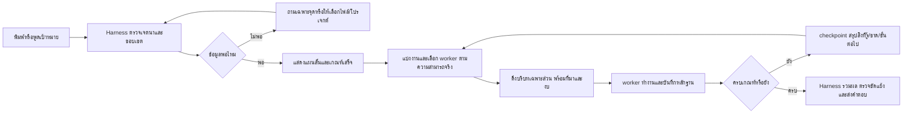

# แผนปรับ Hermetrix: บริบท, ตัวคุมงาน และ Workspace ที่ใช้ง่าย

> อัปเดต 2026-09-27: ตาราง 16k ด้านล่างเป็นหลักฐานจากการตรวจครั้งแรก ก่อนเปลี่ยน runtime. ขณะนี้ Bonsai `llama-server` บนพอร์ต 8088 รัน `-ngl 999 -c 65536 -np 1 --fit off` และ `/props` รายงาน `n_ctx=65536`. โปรไฟล์ `Bonsai main 64k` ผ่าน runtime qualification (`certified-64k`, grade B, allocated 65,536); `Bonsai worker 16k` ใช้โมเดลและเซิร์ฟเวอร์เดียวกันแต่จำกัดบริบทของคำขอไว้ 16,384. ใช้ `scripts/start-bonsai-main64.ps1` เมื่อต้องเปิดเซิร์ฟเวอร์ใหม่. แชทเดิมยังเก็บ session contract เดิม; หน้าแชทใหม่ในไบนารีที่อัปเดตจะเลือกโปรไฟล์ main 64k ที่ผ่าน qualification เป็นค่าเริ่มต้น.

> ตรวจจริงบน Preview รุ่นใหม่พอร์ต 18741: ส่งข้อความ “ตอบเพียงคำว่า พร้อม” แล้วได้คำตอบ “พร้อม”; session `session_622f23e0b06aab1f18e182fe3be03973` บันทึก `provider_name=Bonsai main 64k` และทั้ง `context_profile` กับ contract เป็น `certified-64k`. ค่าหลอด 218/393,216 ใน UI เป็นงบ token สะสมต่อคำสั่ง ไม่ใช่ขนาด context ต่อการเรียกโมเดล.

วันที่ 2026-09-27 · สถานะ: **แผนปรับจากการตรวจระบบจริงและคำตอบผู้ใช้** · ขอบเขต: Chat, coding assistant, Workspace, การเลือกโมเดล, การส่งงานให้ worker และการแสดง token/context

## 1. สิ่งที่ตรวจพบและความหมายของตัวเลข

คำสั่งที่ตรวจคือ “ช่วยตรวจคุณภาพโค้ดในไฟล์ที่เปิดอยู่ พร้อมเสนอจุดที่ควรแก้ก่อน” ใน session `session_4196e105dab6c606f8d69b55e9a15f0d`. ณ เวลาส่งคำสั่ง **ไม่ได้เลือกไฟล์ใน Code**: UI บอกให้เปิดไฟล์เพื่อแนบบริบท ขณะที่ปุ่มลัดยังยอมให้ส่งคำสั่งที่อ้างถึง “ไฟล์ที่เปิดอยู่”. ระบบจึงไล่ค้นโปรเจกต์กว้าง ๆ แทนการตรวจไฟล์ที่ผู้ใช้หมายถึง

| ตัวเลข | ความหมายจริง | หลักฐานที่ตรวจ | การแสดงผลใหม่ |
|---|---|---|---|
| 65,536 | ความจุที่ประกาศใน provider profile | `context_window=65536`, `context_evidence=declared` | “โมเดลระบุว่า 64k; ยังไม่ยืนยันกับ runtime นี้” |
| 16,384 | ความจุที่ `llama-server` จัดสรรจริงขณะรัน | process `-c 16384 -np 1`; `/props` และ `/slots` รายงาน 16,384 | “Runtime ปัจจุบัน 16k” |
| 12,288 | งบ input ต่อการเรียกโมเดลของ `compact-16k` หลังกัน output/ความไม่แน่นอน | session contract และ `internal/context/profile.go` | แถบ “บริบทต่อรอบ” พร้อม reserve |
| 6,848 | prompt tokens ที่ provider รายงานในการเรียกล่าสุด | last context snapshot | `6,848 / 12,288` (ประมาณ 56%; **ไม่เต็ม**) |
| 58,000 / 98,304 | token **สะสมในคำสั่งเดียว** จาก 12 model steps ไม่ใช่ context ที่ค้างอยู่ | turn usage: input 55,580 + output 2,420 | “ต้นทุนสะสมของงานนี้” แยกจากบริบท |
| 12 / 12 | จำนวนขั้นโมเดลที่อนุญาตต่อ turn | `internal/agent/service.go` `MaxModelSteps: 12` และ failure event | “งานหยุดเพราะครบขั้น”; ต้องมีผลคืบหน้าและทำต่อได้ |

ใน 12 ขั้นนั้นมี tool calls 18 ครั้ง: `workspace.list_files` 9, `workspace.run` 7, `workspace.read_file` 2; มีการแตะ `.git` และคำสั่ง `ls` บน Windows ล้มเหลว. ไม่มีคำตอบสรุปที่ใช้งานได้ก่อน `agent exhausted its 12 model-step budget`. ดังนั้นเหตุขัดข้องหลัก **ไม่ใช่ 64k เต็ม** แต่เป็น scope ไม่ชัด, การเลือกเครื่องมือซ้ำ และการจบงานแบบทิ้งผลเมื่อชน step limit.

snapshot ล่าสุดมี identity 1, authority 1 และ session events 37 รายการ; ไม่พบ Project Brain หรือ skill fragment ถูกเลือก, ไม่มี fragment ถูกทิ้งเพราะเกินงบ (`dropped_tokens=0`). สิ่งนี้บอกได้เฉพาะการเรียกนั้น: ระบบไม่ได้ยัด Project Brain ทั้งก้อนจน context เต็ม และไม่ได้ส่งไฟล์เป้าหมายที่ผู้ใช้ต้องการตรวจเข้าไป. รายละเอียดจาก tool schema ใช้ประมาณ 2,816 token ใน input ที่คาด 7,566 token จึงควรลดรายการ tool ที่ส่งตามชนิดงาน.

อีกสองจุดที่เป็นรากปัญหา:

1. `bestProfileFor()` ใน `internal/web/ui/app.js` เลือก profile ที่รับได้ **เล็กที่สุด**; coding assistant ใช้มันเมื่อสร้าง session. ชื่อโมเดลว่า 64k จึงไม่ได้หมายความว่าแชทจะเปิด 64k. Session ที่สร้างแล้วตรึง profile ไว้ ไม่เปลี่ยนตาม runtime ภายหลัง.
2. ตัวเลือก profile อาศัยความจุที่ provider *ประกาศ* มากกว่าความจุจริงที่ runtime รายงาน. ต้องตรวจความเข้ากันทั้งสองฝั่งก่อนเสนอ 32k/64k. ปัจจุบันไม่มี qualification run ที่ยืนยัน 64k.

ภาพหน้าจอ Edge ที่ส่งยังเป็นหน้าเก่าที่เปิดค้าง (`?v=workspace-oneclick`); Preview ปัจจุบันเสิร์ฟ JavaScript รุ่นใหม่กว่า และเคยแก้ default pane บางส่วนแล้ว. แผนนี้ยังถือว่าความสับสนเรื่อง UI จริง: หน้าเก่าค้างโดยไม่บอกผู้ใช้ว่าอัปเดตแล้ว และรุ่นปัจจุบันยังมีลำดับชั้น/การแสดงสถานะซ้ำ.

## 2. หลักออกแบบที่ตกลงกัน

- **Harness เป็นตัวคุมงานหลัก**: รับเป้าหมาย, ตั้ง scope/เกณฑ์เสร็จ, เลือก worker และโมเดลตามความสามารถที่ตรวจได้จริง, ส่งงานย่อย, รวมหลักฐาน, ทบทวน แล้วสรุปให้ผู้ใช้. ไม่ส่งทุกอย่างเข้าโมเดลเดียวโดยอัตโนมัติ.
- **ขนาด context เป็นเพดานต่อการเรียก ไม่ใช่ขนาดสูงสุดของงาน**: งานใหญ่ทำต่อได้ผ่าน task state, checkpoints, evidence และการแบ่งส่วน. แต่ละคำขอเลือกเฉพาะบริบทที่จำเป็น.
- **ความจุจริงเป็นขอบเขต**: เลือก envelope ไม่เกินค่าต่ำสุดของ model capability ที่พิสูจน์แล้ว, runtime allocation, session profile และงบหลัง reserve. “รองรับ 64k” ต้องมาจากการรันจริงและ qualification; ถ้าไม่ผ่าน ให้ใช้ 16k/32k พร้อมบอกเหตุผล.
- **ข้อกำหนดที่ห้ามตกหล่นอยู่ใน packet บังคับ**: goal, ข้อจำกัด, authority, เกณฑ์ตรวจรับ, revision และแหล่งอ้างอิงต้องติดไปกับ worker ทุกชิ้น; สรุปหรือบีบอัดได้เฉพาะประวัติ/หลักฐานที่ไม่ใช่คำสั่งบังคับ. ถ้า packet ใหญ่ ให้แบ่งงานแทนตัดทิ้งเงียบ ๆ.
- **หน้าจอเริ่มเรียบง่ายตามที่ผู้ใช้เลือก**: Chat + แถบสถานะสั้น ๆ; Files, Code, Context, Review, Terminal เปิดเมื่อใช้จริง เพิ่ม/ย้าย pane ได้โดยไม่จำกัดจำนวนเชิงผลิตภัณฑ์ (ยังมีขอบเขตประสิทธิภาพ/หน่วยความจำของเบราว์เซอร์).

## 3. Flow ใหม่ที่ผู้ใช้จะเห็น

ตัวอย่าง “ตรวจคุณภาพโค้ดในไฟล์ที่เปิดอยู่”: ถ้าไม่เปิดไฟล์ ปุ่มจะพาไปเลือกไฟล์ก่อน และยังเก็บข้อความที่พิมพ์ไว้. ถ้าผู้ใช้ตั้งใจตรวจทั้งโปรเจกต์ ต้องเลือก “ตรวจโปรเจกต์” ที่บอกขอบเขต, วิธีสุ่ม/เรียงไฟล์, เวลาคาดหมายและเกณฑ์เสร็จ. การตรวจแต่ละไฟล์ใช้ worker/packet เฉพาะส่วน แล้ว Harness รวมประเด็นซ้ำ จัดลำดับความเสี่ยง และอ้างไฟล์/บรรทัด/การทดสอบจริง. ถ้ายังไม่ครบ ให้เห็นความคืบหน้าและขั้นต่อไป แทน error เปล่า.

## 4. แบบ Workspace และลำดับข้อมูล

**ระดับ 1 — แถบแอปเดียว:** Project, Chat, Plans, Workspace, ค้นหา/ตั้งค่า. ไม่เขียน “Workspace” ซ้ำในหลายชั้น. สถานะเครื่อง CPU/RAM/GPU/VRAM ย่อได้ และไม่แย่งพื้นที่งานหลักบนมือถือ.

**ระดับ 2 — แถบงานสั้น:** เป้าหมาย/ชื่องาน, สถานะ (`กำลังทำ`, `ต้องเลือกไฟล์`, `ต้องอนุมัติ`, `เสร็จ`), ปุ่ม “ดูแผน/รายละเอียด”, ปุ่ม “เพิ่มช่อง”. ไม่ใช้ Agent/Editor และ view dropdown ที่ทำหน้าที่ทับกันเป็นทางหลัก.

**ระดับ 3 — พื้นที่งาน:** ค่าเริ่มต้น Chat หนึ่งช่องกับ composer เดียว; ไฟล์ที่เปิดจาก Files ค่อยเพิ่ม Code; Files/Context/Review/Terminal เปิดผ่าน “เพิ่มช่อง” หรือ action ในผลลัพธ์. แต่ละ pane มี title, ย้าย/ขยาย/ปิดที่ชัด; ปิด Terminal pane ต่างจากยุติ process และต้องมีปุ่มยุติ session แยกชื่อชัดเจน. บนมือถือแสดงช่องที่เลือกทีละช่อง พร้อมสลับง่ายและ composer พ้น safe area/keyboard.

**สถานะ token ที่มองเห็นทันที:** แสดง `บริบท 6.8k/12.3k` และ `งาน 12 ขั้น · กำลังทำ/หยุด` ใกล้ composer โดยป้ายแต่ละอันระบุ scope/เวลาของการวัด. กด “รายละเอียด” เปิด inspector เดียว ไม่แสดง meter เต็มรูปแบบซ้ำใน Chat, Workspace และ Review.

**Context inspector:** แยก (1) ความจุ runtime/profile และ reserve, (2) สิ่งที่ส่งเข้าโมเดล *รอบล่าสุด*—goal, policy, chat history, ไฟล์/ช่วงบรรทัด, tool outputs, skill, Project Brain, tool schemas, (3) สิ่งที่ย่อ/พัก/ไม่เลือกพร้อมเหตุผล, (4) token สะสมของงานและขั้นงาน, (5) แหล่งวัด `provider actual` / `estimate` / `unknown`. คลิกแต่ละรายการไปยัง receipt/source ได้; ห้ามใช้เลขสะสมแทนพื้นที่ context.

**เวอร์ชัน UI:** ถ้า server มี asset revision ใหม่ ให้แสดง “มีหน้ารุ่นใหม่” และรีเฟรชอย่างปลอดภัยเมื่อไม่มีงานส่งค้าง; เก็บ draft และเตือนเมื่อมีไฟล์ยังไม่บันทึก. ลดปัญหาผู้ใช้เห็น tab เก่าขณะ backend ใหม่.

### ตรวจหน้าตั้งค่า Models / Context / Fidelity ที่ซ้ำกัน

ภาพที่ผู้ใช้ส่งแสดงปัญหาอีกจุด: ทั้งหน้า **Models** และ **Context** ให้กรอกข้อมูล runtime/context คล้ายกัน แต่ข้อมูลไม่ได้เชื่อมกันโดยอัตโนมัติ.

| จุดปัจจุบัน | สิ่งที่ทำจริงจาก source | เหตุที่สับสน | ที่อยู่ใหม่ |
|---|---|---|---|
| Models → `Context window` | ค่าที่บันทึกใน provider config; ผู้ใช้ระบุ 65,536 ได้ แม้ runtime ปัจจุบันจัดสรร 16,384 | ตัวเลขดูเหมือนความจุที่พิสูจน์แล้ว | Models → “ความจุที่ระบุ” ในรายละเอียดขั้นสูง พร้อมป้าย `ยังไม่ตรวจ` |
| Models → `ตรวจความพร้อม` | qualification ของ provider/profile รวมการตรวจหลายชนิด | อยู่คนละที่กับ probe allocation | Models → ปุ่มหลัก “ตรวจโมเดลนี้” ขั้นเดียว แสดงผล allocation → qualification → ข้อจำกัด |
| Context → `Verify local model context` | probe แบบ manual โดยต้องเลือก runtime, model, endpoint ใหม่; ไม่ได้ผูกกับ provider ที่กำลังใช้ | default ในภาพเป็น Ollama แต่ provider ที่ใช้จริงคือ Bonsai/llama.cpp; ตรวจคนละตัวได้ง่าย | ย้าย probe เข้า Models ของ provider นั้น และเติม runtime/endpoint จาก config อัตโนมัติ; กรอกเองเฉพาะโหมดวินิจฉัย |
| Context → `Certified 64k` + sample | profile สำหรับ **ตัวจำลอง** context compiler กับข้อความตัวอย่างที่ฝังใน UI; ไม่เปลี่ยน session หรือยืนยัน 64k ของโมเดลจริง | ชื่อ `Certified` ทำให้เหมือน runtime ผ่านการรับรองแล้ว | “ทดสอบการจัดบริบท (ข้อมูลจำลอง)” ภายใต้เครื่องมือวินิจฉัยขั้นสูง; ติดป้ายว่าไม่ใช่แชทจริง |
| Fidelity | benchmark การรักษาข้อมูลหลังบีบอัดจากชุดทดสอบ | เป็นห้องทดลองอีกหน้าใกล้กับ Context และ Models | เครื่องมือวินิจฉัยขั้นสูง รวมกับ context simulation แต่แยกผลวัด |
| Chat/Workspace/Review → token/context | แสดง profile, meter, usage หรือ snapshot ซ้ำหลายตำแหน่ง | ผู้ใช้ไม่รู้ว่าตัวไหนเป็นข้อมูลปัจจุบัน | แถบสถานะย่อที่เดียว + inspector “บริบทที่ใช้ในงานนี้” ที่เปิดจากทุกหน้า |

**โครงเมนูใหม่:** `Settings → Models` เป็นจุดเดียวสำหรับเพิ่มโมเดล, ความจุที่ระบุ, ความจุ runtime ที่ตรวจได้, คุณภาพ qualification และทดสอบใหม่. ในแชทมีเพียงตัวเลือกโมเดลกับสถานะสั้น ๆ; กด “รายละเอียดบริบท” เพื่อดูของ **session/คำสั่งจริง**. `Diagnostics` เป็นหน้าขั้นสูงสำหรับ developer ที่มี probe manual, context simulation และ Fidelity; ไม่อยู่ในเมนูหลักสำหรับการใช้งานปกติ. Deep link เก่าของ Context/Fidelity ต้องพาไปเครื่องมือใหม่โดยไม่ทำให้ข้อมูลผลทดสอบเดิมหาย.

**กติกาการแสดงผล:** แยก `ระบุไว้`, `runtime ตรวจแล้ว`, `qualification ผ่าน`, `session กำลังใช้` ด้วยคำและเวลา; ห้ามใช้คำว่า `Certified 64k` กับตัวเลือกการจำลองลอย ๆ. ถ้า provider ระบุ 64k แต่ runtime จัดสรร 16k ให้แสดง `ใช้งานได้ขณะนี้ 16k` และทางเลือก “ดูวิธีทดสอบ 64k” โดยไม่สร้าง session 64k เอง.

## 5. แผนแก้ระบบตามลำดับ dependency

### A. วัดจริงและแก้คำอธิบายสถานะ

1. เพิ่ม runtime capability probe จาก `/props`/slot/config และบันทึก fingerprint, allocation, จำนวน slot, quantization, VRAM ที่เกี่ยวข้อง; แยก declared/observed/qualified.
2. ปฏิเสธ profile ที่ใหญ่กว่า allocation จริง; เมื่อต้องการ 64k ทดสอบ runtime ในสภาพแยก, latency/VRAM และ recall ใกล้ปลายบริบท. อย่าเปลี่ยน session เดิมเงียบ ๆ; เสนอสร้าง session ใหม่พร้อมสรุปข้อกำหนดและ evidence ที่ย้าย.
3. แก้ selection จาก “เล็กที่สุดที่รับได้” เป็น policy ของ Harness: เลือก envelope จากงาน, ปริมาณ context ที่ประมาณไว้, reserve และ capability จริง; ขยายเมื่อจำเป็นหลังตรวจคุณสมบัติ. ผู้ใช้ดู/ปรับได้.
4. แยก API/telemetry สำหรับ `last_model_input`, `session_context_profile`, `runtime_allocated`, `turn_cumulative_usage`, `model_steps`, `worker_task_progress` พร้อมแหล่งวัดและ timestamp.

### B. ทำ routing และการจัดบริบทแบบงานยาว

1. แปลงคำสั่งเป็น scope: file/selection/project/repository หรือถามผู้ใช้เมื่อคำว่า “ไฟล์นี้” ไม่มีไฟล์. ไม่ให้ quick action ส่งคำขอผิดบริบท.
2. สร้าง task manifest ที่ระบุ goal, acceptance, constraints, plan revision, owner และ allowed effects; สร้าง packet ย่อยจากระบบ Task ที่มีอยู่ (`internal/taskengine/packet.go`) ไม่สร้าง queue/สถานะงานคู่ขนาน.
3. ให้ Harness เลือก worker จาก capability, context/runtime, tools, cost/latency และนโยบาย local/authority. Worker รับเฉพาะไฟล์/หลักฐานที่จำเป็น; ห้ามทำให้เนื้อหาภายนอกกลายเป็นคำสั่ง.
4. Retrieval จัดอันดับตามคำถาม, ไฟล์ที่เลือก, project symbols, ความใหม่ และ provenance; ตัดไฟล์ซ้ำ, จำกัดช่วงบรรทัด, บอกเมื่อย่อ/ตัด, กันงบสำหรับคำตอบ. Tool schemas เฉพาะขั้นที่ต้องใช้ ลดค่าใช้จ่ายซ้ำ.
5. แบ่งงานใหญ่ตามไฟล์/โมดูล/เกณฑ์; worker ส่ง findings พร้อม evidence และ coverage; Harness dedupe, ตรวจความขัดแย้ง, ตรวจช่องว่าง และสรุปภาพรวม. ไม่ตีความว่า “อ่านสองไฟล์” คือ “ตรวจทั้งโปรเจกต์”.
6. มี checkpoint ที่คงข้อกำหนดบังคับและรายการยังไม่เสร็จ; งานต่ออัตโนมัติข้าม turn/worker slice ภายใต้เพดานทรัพยากรและ policy ของงาน. เมื่อชนเพดานเวลา/compute/approval หรือพบ loop ให้แสดงผลคืบหน้า, สิ่งที่ยังไม่ตรวจและปุ่มทำต่อ; ไม่ทิ้งผลทั้งหมด.

### C. ป้องกัน agent วนและจบแบบล้มเหลว

1. ตรวจการเรียกเครื่องมือซ้ำ (`list_files` path เดิม, `run` สำรวจซ้ำ) และบังคับเปลี่ยนกลยุทธ์หรือสรุปหลักฐานก่อนเรียกอีก.
2. เตรียม “ช่วงสรุป” ก่อนหมด slice budget พร้อมห้าม tool call จริงในขั้นสุดท้าย; ถ้า provider ยังส่ง tool call ให้ server สร้าง partial result/checkpoint ที่อ่านได้ ไม่ส่งเพียง `model-step budget`.
3. แก้คำสั่ง shell ตาม OS หรือใช้ API สำหรับ file listing โดยตรง; ป้องกัน `ls` บน Windows ที่เสียหนึ่งขั้นโดยไม่เกิดหลักฐาน.
4. แสดง `coverage`, `ล่าสุดกำลังตรวจอะไร`, `เหตุผลที่เลือก worker`, `next action` แบบย่อ ไม่ปล่อย skeleton/loading ค้างเมื่อ turn ล้มเหลว.

### D. ลด UI ซ้ำและตรวจจริง

1. รวม Chat, coding Chat และ Review ให้ใช้ตัวข้อมูลสถานะเดียว, composer ที่สัมพันธ์กับงานเดียว, model selector ที่เดียว; Review เป็นรายละเอียดแบบเปิดเมื่อร้องขอ.
2. ปรับ default Workspace เป็น Chat + สถานะย่อ; Code ปรากฏเมื่อเปิดไฟล์. “เพิ่มช่อง” ให้เลือก Files/Code/Context/Review/Terminal/ฯลฯ และจัดตำแหน่งได้โดยไม่บังคับ grid หรือจำกัด 4 ช่อง.
3. รวมการตั้งค่า provider, probe allocation และ qualification ใน Models ของ provider เดียว; แสดงค่าที่ระบุเทียบกับ runtime/qualification/session อย่างไม่กำกวม. ย้ายตัวจำลอง compiler และ Fidelity ไป Diagnostics ขั้นสูง พร้อม deep link เดิมที่พาไปถูกจุด.
4. ตรวจ flow จริงบน desktop/mobile: ไม่มีไฟล์ → เลือกไฟล์ → review → เห็นหลักฐาน/บริบท/การใช้ token → ทำต่อ → เปิดไฟล์ผล. ตรวจ safe area, keyboard, scroll, focus และข้อความไทย.
5. ทดสอบแยก runtime 16k กับ 64k ที่ qualified, task สั้นและใหญ่, ข้อมูล Project Brain ที่เกี่ยวข้อง/ไม่เกี่ยวข้อง, worker fail/loop/cancel/restart และหน้าเก่าค้าง.

## 6. เกณฑ์รับงานที่ตรวจได้

- ถาม “ตรวจไฟล์ที่เปิดอยู่” โดยไม่มีไฟล์: ไม่เริ่ม agent; ชวนเลือกไฟล์และเก็บ draft. เมื่อเลือกแล้ว receipt ระบุ path, revision, ช่วงบรรทัดและ token estimate ก่อนส่ง.
- งานตรวจทั้งโปรเจกต์: plan แบ่งส่วน, worker แต่ละส่วนมี evidence/coverage, Harness รวมผล; หลังครบ 12 ขั้นใน slice แรกงานยังดำเนินต่อจาก checkpoint หรือแสดงเหตุหยุดที่แก้ได้. ไม่มีสรุปว่าเสร็จถ้ายังมีส่วนที่ไม่ตรวจ.
- runtime `-c 16384`: UI ไม่เสนอ 64k เป็น active; ถ้าทดสอบ 64k ไม่ผ่านมีเหตุผลชัด. ถ้าผ่านจริง session ใหม่ใช้ profile ที่รับได้ และ inspector แสดง capacity/provider tokens ตามแหล่งวัด.
- `last input`, `cumulative turn tokens`, `model steps` และ `runtime capacity` แยกชื่อ/หน่วย/เวลา ไม่ใช้แถบเดียวแทนกัน. ตัวเลขตรวจเทียบ receipt/API ได้.
- header ไม่ซ้ำชื่อ/หน้าที่; Workspace ใหม่เริ่มด้วย Chat และ status ย่อ; Code ไม่แสดงก่อนเปิดไฟล์; desktop/mobile เพิ่ม ย้าย ปิด pane ได้; ปิด pane ไม่ยุติ process โดยไม่ตั้งใจ.
- ตั้งค่าและตรวจ provider ที่หน้า Models จุดเดียว: ไม่ต้องกรอก endpoint/model ซ้ำเพื่อ probe; ตัวจำลองใช้ป้ายว่าเป็นข้อมูลจำลองและไม่เปลี่ยนแชท; session inspector แสดงค่าจริงของ session ที่กำลังใช้อยู่.
- เมื่อโมเดล/tool/worker ล้มเหลว ผู้ใช้เห็นผลที่ตรวจแล้ว สิ่งที่ยังไม่ตรวจ และ action ถัดไป. Draft, file edit และ Task state ยังอยู่หลัง reload/สลับหน้า.

## 7. ขอบเขตการตัดสินใจที่ยังต้องตรวจระหว่างลงมือ

- จะใช้ runtime allocation 64k กับโมเดลที่เลือกได้จริงหรือไม่ ต้องพิสูจน์ด้วย probe และ benchmark บนเครื่องจริง รวม GPU/VRAM สองตัวถ้า runtime รองรับ. การประกาศ 64k ของ provider อย่างเดียวไม่พอ.
- เพดานทรัพยากรรวมของงานยาวต้องตั้งจาก task policy (เวลา/compute/ค่าใช้จ่าย/approval); ผู้ใช้ต้องไม่เจอเพดาน 12 ขั้นแบบไร้ผล แต่ระบบก็ต้องหยุด loop ที่ไม่คืบหน้า.
- งานที่เปลี่ยนไฟล์/เครื่องหรือเผยแพร่ยังใช้ approval gate และ evidence contract ที่ผู้ใช้กำหนดไว้ก่อนหน้า. การทำต่ออัตโนมัติใช้กับงานอ่าน/วิเคราะห์ภายในขอบเขตที่อนุญาต.

แผนนี้ปรับรายละเอียด P2/P3 ของ [แผนหลัก](2026-09-26-goal-driven-workbench-v2-master-plan.md) และไม่เปลี่ยนสถานะ implementation ของส่วนอื่นโดยไม่มีผลตรวจใหม่.
