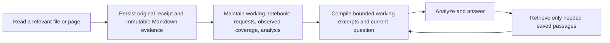

# Durable evidence for project chat

The failure `compiled context exceeds allocated window: compactor exceeded its target` occurred because checkpoint budgeting omitted its own preamble. Whole tool receipts also competed repeatedly with the current question. A cumulative per-turn token allowance (98,304 for compact-16k) was presented as though it were a context window.

## Implemented flow

1. The canonical session event log retains the complete tool receipt. `appendEvent` saves tool evidence before committing the receipt, so a successful archive must precede analysis. Approval receipts and legacy sessions are backfilled during compilation.
2. Evidence is written below the application's data directory, in `evidence/<session SHA-256>/`. Each immutable `.md` source is named by the hash of its event ID and content. Project source files are not changed. `notebook.md` contains all user requests, tool observations with file revision/page metadata, interim analysis, final analysis, and unfinished turns. Analysis is labeled unverified; observed pages do not imply complete repository coverage.
3. Provider context uses a bounded excerpt (up to 1,200 runes for the current turn, 240 for previous turns) and source event IDs instead of replaying large receipts. Excerpts shrink further against the calibrated inline token limit so they are not spilled again; retrieval JSON preserves paging controls and adjusts the next offset when its passage is shortened. A working notebook index is limited to 512 estimated tokens, including a bounded original objective, analysis, recent observation references and an explicit omitted count.
4. `context_search` accepts ordinary topical queries and an explicit `event:ID offset:N` query through its existing frozen schema. Explicit source reads are session scoped and return at most 1,200 Unicode runes, source metadata, total length, next offset and a `has_more` flag. They do not grant filesystem or approval authority.
5. Checkpoints count their entire serialized text, including provenance and retrieval notices, against the exact remaining active slice. The verified compactor rejects oversized primary output and falls back to the bounded extractive compactor. A checkpoint can be empty if no complete causal unit fits; canonical evidence remains available through retrieval.
6. The composer displays the predicted input of the latest model request against the session's usable input budget. Cumulative turn/chat usage stays in details. The composer provides a notebook download and a recovery action for historical context/model-step failures.
7. Deleting a chat removes its derived evidence directory along with the transcript. User-created project files and detached artifacts keep their existing lifecycle.

## Continuation and limits

A chat remains bounded by its existing per-turn model-step, tool-call, time, and cumulative token contract. This change enables continuation across turns and process restarts from durable sources; it does not introduce an unlimited autonomous scheduler or declare a repository review complete after reading a subset. The recovery action starts a new turn from the original objective and saved observations, requesting only needed passages.

Documents are deterministic records and extractive working context, not an independent model's verified conceptual summary. Semantic retrieval remains optional; lexical and explicit source paging work without an embedding provider. Invalid or missing source IDs fail explicitly, and source metadata retains hashes and page coverage for revision-aware decisions. Existing per-step approval rules remain enforced.

## Validation

- Saturated checkpoint targets 32–2,048 tokens at estimator multipliers 1, 1.8 and 2.5; exact budget and causal-pair verification.
- Sixty large file receipts followed by twelve follow-up turns in compact-16k, with a database restart and middle-of-file fact retrieval.
- Unicode paging, cross-session/malformed source rejection, archive write failure before event commit, Thai working-index budgeting and deletion cleanup.
- Real-browser composer/context meter flows at desktop, mobile and short desktop sizes.
- Live Qwen provider: relevant passages in a 442,197-byte fixture, followed by `context_search` reuse of the recorded source without another workspace read.

## Workspace layout and model capacity

New chats inherit the selected workspace. Existing session contracts retain their original scope and context envelope; creating a new chat applies the latest capacity policy. The duplicate chat title and composer scope picker are removed. The input holds a compact context meter, approval selector, small animated character and scroll-to-latest control. Slash commands remain available by typing `/`; the command button is removed.

New chats select the largest registered envelope within the provider-declared context and, when verified, its loaded runtime allocation. A recall test on a smaller profile is not evidence of a smaller runtime allocation. Unqualified larger envelopes retain the existing recorded qualification override; declared remote capacity is not advertised as a verified runtime measurement.

Idle system, skill and tool reservations are available to chat history. Compaction starts above 75% of the usable input window (model envelope minus answer and uncertainty reserves), matching the composer meter. Transport overhead and worst-case next tool burst remain protected and can require selection earlier for hard safety. Pinned goals, source events and notebook documents survive selection.

Boundary tests cover just below, exactly at and just above 75% for 16k and 128k envelopes. UI tests cover declared model capacity, verified runtime caps and ignoring unverified recall allocations.

## Visible answers at tool and step limits

The failing desktop session had two assistant messages with empty content and `finish_reason=stop` after 19 and 23 tool calls, followed by a 23-call turn failing before a batch exceeded the 24-call budget. This was independent of the context-window threshold.

The loop now reserves a tools-disabled summary as the remaining tool budget approaches exhaustion. Over-budget batches and the third identical non-polling call never execute; they transition to summary instead of discarding completed observations. A stop/length completion without user-facing text gets one bounded summary attempt. If the provider still returns no answer or tool-call markup, a deterministic receipt-based progress report is committed with `summary_fallback` and `continuation_needed`, preserving usage and releasing the session lease. Partial outcomes expose the notebook continuation action; they never assert a complete project review. Cumulative-token and time guards remain enforced.

Validation includes repeated empty-stop recovery, length-only reasoning, tool batches exceeding the budget, the loop detector, summary before the model-step limit, usage retention, and lease release. Live Qwen tests read three synthetic fixture files and then verified the same evidence in a following turn using `context_search`, with nonempty answers in both turns. A broad external-provider project review was rejected by automatic approval review because of possible private workspace disclosure; real-provider validation was restricted to verified synthetic files.

The idle desktop server on 127.0.0.1:7331 was restarted with the existing arguments, data directory and provider credential environment; both original sessions and provider readiness were retained.

## Exact easiiot_project reproduction and turn-scoped accounting

The next real failure was `agent exhausted its 589824 cumulative-token budget` after only seven tool calls. Scheduler admission applied the session task budget to the lifetime owner ledger, even though RunTurn starts its usage accumulator at zero for each new turn. Previous turns poisoned all later turns in the same chat.

Inference now carries a separate `TurnTokenLimit`. The scheduler enforces it against reserved, dispatched, uncertain and reconciled entries for the same session and turn. Lifetime `OwnerTokenLimit` semantics remain available to other callers. Agent turns use the turn limit; retries/approval continuation in the same turn still share their durable ledger, while the following turn has a fresh budget. Final-answer reservation uses the larger of the compiled prompt estimate and the provider's observed prompt usage. Budget refusal produces a labeled partial receipt report instead of dropping prior progress. UI partial outcomes state that coverage is not confirmed complete.

Validation on 2026-09-30 used the original desktop app, original `easiiot_project`, original Qwen provider and original failing session `session_9122a4b7b9525d252933a3d6fc45d764`. No replacement fixture was used for these two turns:

| Request | Turn | Model steps | Tool calls | Total reported tokens | Answer characters | Outcome |
| --- | --- | ---: | ---: | ---: | ---: | --- |
| `review over all for project this` | `turn_edbcfc4cc87c5b916eaf59178e3b8996` | 11 | 23 | 342,864 | 2,658 | Model-authored partial review; no fallback or turn failure |
| Composer `ทำต่อจากเอกสาร` | `turn_f631055e53ba7ba7f717473d5e1b9ebd` | 6 | 17 | 246,152 | 3,081 | Model-authored coverage report; no fallback or turn failure |

The replies report structure/config/auth/deployment/frontend observations and explicitly list unchecked handlers, worker/consumer, migrations and tests. These are model-generated review results, not proof of complete repository coverage or independently verified security findings. Neither turn ran the entire build/test suite. The test confirms that the original case returns nonempty review content and can continue despite accumulated historical usage; it does not certify the entire project.

Scheduler regression tests verify new-turn admission after historical charges exceed the per-turn cap, same-turn rejection after scheduler restart, and a following turn's fresh budget. A full-database reproduction copy was rejected by automatic approval review; validation instead used the original app and chat without making that copy. The final desktop server is running on the original port 7331 with original data and provider credentials; starting a second instance against the same root remains intentionally disallowed.
