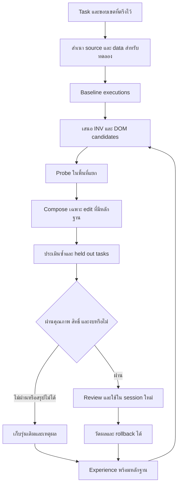

# แผนต่อยอด Hermetrix จาก Harness²

วันที่ตรวจเริ่มต้น: 25 ตุลาคม 2026 · ตรวจ upstream ล่าสุด 26 ตุลาคม · อัปเดตผล Hermetrix 27 ตุลาคม 2026

สถานะ source ล่าสุด: ปรับตัวค้น Project Brain เข้า source จริง 4 ไฟล์ Go และข้อมูลทดสอบหนึ่งไฟล์ หลังนำเข้าทั้ง repository ผ่าน 1,435 test events/0fail/20skip พร้อม vet/build ผ่าน ทดลอง Bonsai จริง 30 คำตอบจากหนึ่งบทเรียน พบความรู้2/8→7/8 และตอบขั้นตอนครบ1/8→7/8 แบบปิด Brain0/8 ส่วนใหญ่เป็นการงดตอบเมื่อข้อมูลไม่พอ คำถามนอกเรื่อง2ข้อไม่ดึงบทเรียนเข้ามา ต้นทุน token และเวลาโมเดลเพิ่มขึ้น ไทยล้วนยังพลาด ดู [รายงานการวัด Project Brain](../handoffs/2026-10-27-project-brain-measurement-results.md) ผลนี้ยังไม่ใช่การวัดความสามารถเขียนโค้ดทั่วไปหรือ self-learning

พื้นฐาน host ที่ใช้อยู่คือ H1A8b/schema80 ซึ่งนำเข้า source จริงแล้ว37ไฟล์ (production16/test21), ตรวจ ancestry121ขั้น, review8ชุด และ native write37receipts/0rollback ผ่าน actual post-apply1,421test events ก่อนงาน Brain ทดลอง Bonsai จริงผ่าน host API ตั้งแต่ auto-plan จนเสร็จ4calls/11actions และตรวจ replay58ครั้งไม่สร้างงานหรือเรียกโมเดลเพิ่ม ตัวอย่างเป็นงานแก้เลขคณิต บทพิสูจน์ปัจจุบันจึงยังไม่ครอบคลุมงานธุรกิจซับซ้อนหรือ learning transfer ตัวแอปที่ติดตั้งอยู่ยังไม่ได้อัปเดตในรอบเหล่านี้

บันทึก candidate32 ของ H1A8 เป็นประวัติก่อน apply; source37ปัจจุบันแทนที่แล้ว ดู [สถานะสำหรับทำงานต่อ](../NEXT_SESSION.md) และ [หลักฐานหลังนำเข้า](../validation/2026-10-27-harness-checkpoint.json)

ประวัติ H1A6 ก่อนหน้า: H1A6 นำ API claim แบบครั้งเดียวและตรวจ freshness เข้า source แล้ว 13 ไฟล์ ผ่าน review 4 ชุดและ apply 13 receipts ไม่มี rollback หลังนำเข้าทั้ง repository ผ่าน 1,365 events, 0 failures, 20 skips และ vet/build ผ่าน ดู [ผล claim และงานต่อ](../handoffs/2026-10-27-h1a6-claim-apply-results.md) ยังต้องเชื่อม host resolver/orchestrator/runner, completion/provenance และ promotion gate ก่อนอ้าง self-learning

ก่อนหน้า H1A5 นำ prepared-run metadata เข้า source จริง 28 ไฟล์ schema 79 ผ่าน native review 6 ชุดและ apply 28 receipts ไม่มี rollback หลังนำเข้าทั้ง repository ผ่าน 1,353 events, 0 failures, 20 skips พร้อม vet/build ผ่าน ดู [ผล H1A5](../handoffs/2026-10-27-h1a5-prepared-run-apply-results.md) ข้อความลงวันที่ 26 ตุลาคมด้านล่างเป็นประวัติและ baseline ของรอบนั้น

ตรวจทานตามคำขอวางแผนอีกครั้งวันที่ 26 ตุลาคม: upstream ยังเป็น commit เดิม ตรวจเทียบเส้นทาง recursion, selection, reflection, library, budget, resume และ executor กับ source ใน working tree ของ Hermetrix รอบทบทวนนี้ปรับเฉพาะเอกสาร ไม่เริ่ม implementation ไม่เรียกโมเดล และไม่รัน benchmark เพิ่ม ผลทดสอบที่ระบุด้านล่างเป็นผลของรอบที่บันทึกไว้ตามวันที่ ไม่ใช่ผลทดสอบใหม่ของรอบวางแผน

ความคืบหน้า 26 ตุลาคม: Hermetrix ลงมือแก้ส่วนการอ่านหลักฐานและนับ regression รายกรณีแล้ว พร้อมผลทดสอบและ native apply; ดู [ผลการลงมือจริง](../handoffs/2026-10-26-h1b-live-worker-results.md) การผูกกับรันจริง ขอบเขต Skill และงานเต็มส่วนอื่นยังอยู่ระหว่างดำเนินการ ผลตรวจด้านล่างเป็น baseline ณ วันที่ตรวจเดิม

ข้อเสนอหลักคือรักษา runtime, Session Contract, Task/Goal engine และระบบหลักฐานของ Hermetrix แล้วเพิ่มวงจรทดลองปรับ harness แบบ Propose–Probe–Compose ในห้องทดลองแยก การย้ายทั้งระบบไปใช้ Harness² ยังไม่มีหลักฐานว่าจะคุ้มกว่า และจะเพิ่มภาระเชื่อม Python/Linux เข้ากับผลิตภัณฑ์ Go/Windows ของเรา

การลงมือพบข้อจำกัดไฟล์ใหญ่ 128 KiB จึงเพิ่ม H1D ก่อนงานที่ต้องแก้ agent/service.go ส่วน A1/A2 และ worker transport A3 นำเข้าจริงแล้ว ต่อมา B รวม durable input, coordinator, bounded reviewer และ automatic curation เป็น candidate 67 ไฟล์ ผ่านชุดทดสอบรวมและการทดลอง native Goal กับโมเดล local จริงบน Go source 480,099 bytes: ก่อนแก้ test ล้มเหลว หลัง native apply test ผ่าน และ separate-profile review อนุมัติ พร้อมปิด/เปิด SQLite และ services กลาง workflow โดยไม่เสนอซ้ำ B6 review อนุมัติ 17 ชุดและ native apply เข้าตัวหลักทั้ง 67 ไฟล์แล้ว หลัง apply ทดสอบทั้ง repository ผ่าน 1,315 test events (20 opt-in/environment skips), vet/build ผ่าน และ native Go fixture ใหม่ผ่านจริง ดู [ผลนำเข้า B6](../handoffs/2026-10-26-b6-native-apply-results.md) กรณี Go นี้มี comment padding และ arithmetic declaration เล็ก จึงยังไม่พิสูจน์การรับงานระบบธุรกิจขนาดใหญ่ ดู [ผล curation](../handoffs/2026-10-26-automatic-context-curation-results.md) และ [ผล native Go](../handoffs/2026-10-26-native-large-go-goal-results.md)

การเขียนและซ่อมในรอบนี้มี Codex กำกับ packet, ตรวจ fixture และสั่ง native worker จึงยังไม่พิสูจน์ว่าระบบเรียนรู้บทเรียน ประเมิน เลื่อนรุ่น และทำงานถัดไปดีขึ้นได้เองครบวงจร ต้องแยกผลของการควบคุมงานออกจากผลของ self-learning ในการทดลองระยะถัดไป

อัปเดต H1B2: นำ native gate เข้าจริงแล้ว คะแนนรวมที่ไม่มี paired Result ไม่ authorize promotion และตรวจ stored paired counts/verdict ใหม่ตอน promote พร้อม 5 aggregate/5 historical/positive cases ผ่าน native review/apply5receipts/0rollback หลัง apply ทั้ง repository ผ่าน1,328test events/0failed/20opt-in skips,vet/buildผ่าน ดู [ผล H1B2](../handoffs/2026-10-26-h1b2-evidence-gate-results.md) H1A run identity ก่อนเริ่มและ H1C scope ยังไม่เสร็จ

อัปเดตภายหลัง H1E1: ปรับ request schema ให้ระบุจำนวนและ path ที่เขียนได้จริง ผ่าน native review/apply 7 files และ actual full repository 1,337 passing events/0fail/20skips พร้อม vet/build ผ่าน ดู [ผลและข้อจำกัด H1E1](../handoffs/2026-10-26-h1e1-request-schema-results.md) รวมการแก้ชื่อสำเนา evidence ของ H1B2 เป็น `.go.txt` โดย bytes เดิม เพื่อไม่ให้ปะปนใน Go build ผล H1B2 ด้านบนเป็นประวัติรอบก่อนจัดเก็บ evidence ส่วนผล H1E1 ตรวจหลังจัดเก็บและแก้ปัญหานี้แล้ว

สถานะก่อน H1A5 วันที่ 26 ตุลาคม: ผู้ใช้ยืนยันใช้ Bonsai Local ต่อ Schema ช่วยให้ live trial ตอบจำนวนไฟล์ตรงขอบเขต แต่ trial ยังผิดไวยากรณ์ จึงไม่ใช่หลักฐานการซ่อมสำเร็จหรือ self-learning ตอนนั้น H1A immutable run ยังเป็นร่าง ไม่ apply ส่วน dynamic UX/control, marketplace Compose และ actual Kubernetes ยังคงเป็นเป้าหมายเต็ม

อัปเดต H1A3: candidate cohort23filesมี Prepare/Get ที่ pinข้อมูลก่อน effect, caller-suppliedrunIDและidempotent replay, actualSQLite/servicesreopen และ actualownedproject/session+crossscope tests ผ่านทั้งskills/store/agent301events/0fail/4skips,vet/buildผ่าน แต่ยังไม่review/apply actualsourceยังschema78 และ RecordBehavioralEval/promotionจริงยังไม่requiretrustedrun จึงยังไม่ปิดH1Aหรืออ้าง self-learningครบวงจร ดู [ผลและข้อจำกัด H1A3](../handoffs/2026-10-26-h1a3-prepared-run-candidate-results.md) ก่อนทำstale/concurrent/inactive/scannernegative tests และเชื่อมrunner/provenance/promotion

สิ่งที่ควรทำก่อนคือทำให้หลักฐานการเรียนรู้และเกณฑ์รับ candidate ของเราน่าเชื่อถือขึ้น จากนั้นจึงทดลองว่าแนวทางของ Harness² ช่วยงานจริงได้มากเพียงใด ยังไม่ควรเปิดให้ระบบปรับคำสั่งหลัก เครื่องมือ หรือสิทธิ์ตัวเองจากคะแนนรวมเพียงอย่างเดียว

## สถานะล่าสุดและลำดับที่ควรทำ

ตรวจ upstream อีกครั้งวันที่ 26 ตุลาคมพบว่า `main` ยังเป็น commit `1cfe254e8d25b15f37048c3730134686abe60335` จึงใช้ snapshot เดียวกับการวิเคราะห์เดิม ส่วน Hermetrix ต้องพิจารณาทั้ง HEAD และ working tree เพราะมีการแก้ไขที่ยังไม่ commit รอบปรับแผนนี้แก้เฉพาะเอกสารและรัน tests ไม่มีการแก้โค้ดผลิตภัณฑ์หรือเรียกโมเดลเพื่อทดลองคุณภาพ

| งาน | สถานะที่ตรวจล่าสุด | งานถัดไป |
|---|---|---|
| ตรวจ regression เป็นคู่รายกรณี | H1B2 นำ gate เข้าจริงแล้ว; aggregate-only และ historical stored-pass ไม่ authorize | ผูก paired evidence กับ immutable run และ trusted runner ก่อน promote |
| ผูกผลกับรุ่นที่เริ่มทดลอง | `RecordBehavioralEval` ยังอ่าน revision/hash ณ เวลารับผล | สร้าง immutable run ก่อน dispatch และรับผลตาม run identity เดิม |
| ขอบเขต Skill | background ผูก source project; direct `skill_manage` ยังเริ่ม `ScopeKind: user` | ใช้ host resolver เดียวกันและทดสอบด้วย project/session ที่เป็นเจ้าของจริง |
| Skill ใหม่และการเลื่อนรุ่น | behavioral gate ทำงานเมื่อ `ReplayRequired` | เพิ่มการตรวจงานจริงสำหรับการสร้าง Skill ที่จะเปิดใช้ผ่าน automation |
| งานไฟล์ใหญ่ | A3 และ B67 อยู่ใน source; B6 review17/apply67 ผ่าน และ post-apply tests/native Go fixture ผ่าน | ผ่านตรวจหลัง apply แล้ว; ยังต้องงานหลายไฟล์ซับซ้อนและ holdout ไม่ใช้ fixture นี้แทนงานธุรกิจใหญ่ |
| การเรียนรู้ครบวงจร | มี outbox, reviewer, candidate และ planning lab | เพิ่มคู่การทำงานจริงและพิสูจน์การนำบทเรียนไปช่วยงานถัดไปบน holdout |

ชุดงานไฟล์ใหญ่ผ่าน review/apply และ post-qualification แล้ว ลำดับถัดไปคือปิดช่องโหว่ evaluation และ scope ก่อนเพิ่ม Propose–Probe–Compose ใน lab เริ่มจาก Skill และ tool guidance เท่านั้น ส่วนสิทธิ์ owner/project, approval, evaluator, budget ceilings และการตัดสินว่างานเสร็จต้องอยู่ภายใต้ host

ชุดทดสอบที่รันใหม่ใน working tree วันที่ 26 ตุลาคมผ่านทั้งสาม package: `internal/skills`, `internal/learning`, `internal/selfimprove` โดยใช้ `go test ... -count=1` ผลนี้เป็นการตรวจระดับ package และ fixture ไม่ใช่การรัน benchmark โมเดลหรือพิสูจน์คุณภาพงานปลายทาง

### แผนอ่านส่วนประกอบของ Harness²

| ส่วน | ไฟล์หลัก | หน้าที่และสิ่งที่ควรนำมาใช้ |
|---|---|---|
| คำสั่งเริ่มงานและ configuration | `cli/run_sweep.py`, `config.py`, `core/spec.py` | เลือก benchmark, executor, model, budget และแยก adapter ออกจากวงจรทดลอง |
| การจัดลำดับและ resume | `core/schedule.py`, `core/runmark.py` | ทำ task stream ตาม domain, ตรวจ configuration/fingerprint และคืนสถานะ library ตามงานก่อนหน้า |
| การเสนอและประกอบ harness | `core/recursion.py`, `core/proposer.py`, `core/prompts.py` | INV/DOM proposals, executions และ composition ที่ใช้ contrasts |
| ข้อมูลที่ editor อ่าน | `core/context.py` | source, trajectory, deliverable, diff และ decision evidence พร้อมตัวกรอง grader |
| ขอบเขต component ที่แก้ได้ | `core/tree.py`, `substrate/opencode.py`, `substrate/codex.py` | ตรวจ path, hook, Skill และการนำ harness ไปติดตั้งใน executor |
| การเลือกและกลั่นบทเรียน | `core/selection.py`, `core/library.py` | เลือก deliverable, reflection, evidence-supported lesson และ component reuse |
| งบและการประเมิน | `core/ledger.py`, `core/judge.py`, `core/report.py` | แยกจำนวน executions/editor stages ออกจากการตัดสิน benchmark และรายงานต้นทุน |
| งานและ runtime ภายนอก | `benchmarks/`, `install.py`, `preflight.py`, `dependencies/`, `third_party/` | adapter ของ JobBench/LAB/WorkBuddy, dependency pinning และ license แยก |
| การทดสอบวงจร | `tests/test_workflow.py`, `demo.py` | ตรวจ budget/resume/evidence/library/failure แบบ deterministic; ไม่ใช้แทน model benchmark |

ตารางนี้เป็นแผนที่ของเส้นทางหลัก ไม่ได้หมายความว่า asset, third-party file และทุกบรรทัดได้รับการ audit ความปลอดภัยทั้งหมด

## ขอบเขตและหลักฐาน

- Harness²: ตรวจ tree ทั้ง repository และอ่านเส้นทางหลักของ CLI, configuration, recursion, proposal, evidence, composition, selection, reflection, library, executor adapters, benchmark adapters, install/preflight และ tests ที่ commit `1cfe254e8d25b15f37048c3730134686abe60335` วันที่ 14 ต.ค. 2026
- Hermetrix: ตรวจ source ที่ HEAD `4459036638527a68dec0a14d2fab8d87e08c13e3` วันที่ 23 ต.ค. 2026 โดยเน้น agent, learning, skills, selfimprove, context, taskeval, taskcoord, taskengine และ Project Brain
- รันทดสอบ Harness² และ demo แบบ deterministic ซึ่งไม่เรียกโมเดลจริง; รันทดสอบส่วนที่เกี่ยวข้องของ Hermetrix และสร้าง probe ผ่าน Go overlay ที่อยู่นอก source workspace
- รอบนี้ไม่ได้รัน benchmark แบบจ่ายค่า API ไม่ได้ทดสอบโมเดลสองระบบแบบตัวต่อตัว และไม่ได้เปลี่ยน executable หรือข้อมูลระบบที่ให้บริการ

คำว่า “มีใน source”, “ผ่านการทดสอบด้วย fixture” และ “ทำให้งานของผู้ใช้ดีขึ้นจริง” เป็นหลักฐานคนละระดับ รายงานนี้ไม่ใช้จำนวน tests หรือผลจาก paper เป็นคะแนนความเก่งของ Hermetrix

## Harness² ทำอะไร

Harness คือส่วนรอบโมเดลที่กำหนดวิธีทำงาน ได้แก่ คำสั่ง ทักษะ ความจำ เครื่องมือ และการประสานงาน Harness² ทดลองปรับส่วนเหล่านี้โดยตรึงน้ำหนักโมเดลไว้ จึงเป็นการเรียนรู้วิธีทำงานและเก็บประสบการณ์ ไม่ใช่ fine-tuning โมเดล

โครงสร้าง source แบ่งหน้าที่ค่อนข้างชัด:

| ส่วน | บทบาท |
|---|---|
| `harness2/cli` | setup, ตรวจความพร้อม, เลือกงาน, เริ่ม recursion, judge และ report |
| `core/spec.py` | สัญญาระหว่างวงจรปรับ harness กับ benchmark/executor |
| `core/tree.py` | กำหนดไฟล์ที่แก้ได้ ตรวจรูปแบบ ขนาด frontmatter และ syntax ของ Python scripts |
| `core/proposer.py` และ `prompts.py` | ส่งโจทย์ให้ editor ปรับ harness พร้อมข้อจำกัดและหลักฐาน |
| `core/context.py` | จัด source, trajectory, deliverable, diff และ library เป็นไฟล์ให้เปิดอ่าน |
| `core/recursion.py` | วงจรเสนอ ทดลอง และประกอบ harness ทั้งแบบ parallel/sequential |
| `core/selection.py` | เลือก deliverable และสกัดบทเรียนหลังรับผลลัพธ์ |
| `core/library.py` | เก็บ harness ที่รับไว้พร้อมเงื่อนไขการใช้และหลักฐาน |
| `core/schedule.py`, `runmark.py`, `ledger.py` | ลำดับงาน การกลับมาทำต่อ fingerprint และการนับงบการทดลอง |
| `substrate` | แปลง harness เป็นรูปแบบของ OpenCode หรือ Codex |
| `benchmarks` | เชื่อม JobBench, LAB และ WorkBuddy-Bench รวมการอ่านชิ้นงานและให้คะแนน |
| `dependencies`, `third_party` | เวอร์ชัน แหล่งที่มา runner/patch และ license ของ dependency ภายนอก |

แปดส่วนที่ปรับได้ในแนวคิดมีดังนี้ แต่ไฟล์จริงขึ้นกับ executor และ benchmark บางตัวปิด subagents จึงไม่ควรตีความว่าทุก configuration ใช้ทุกส่วนได้เหมือนกัน

| ส่วน | ปรับเพื่ออะไร | สิ่งที่ควรนำมาใช้กับ Hermetrix |
|---|---|---|
| System prompt | เปลี่ยนวิธีวางแผนและทำงาน | เริ่มจาก addon/checklist ที่มี version และงบ context |
| Guardrails | เพิ่มกติกาในคำสั่งของ agent | แยกคำแนะนำที่เรียนรู้ได้ออกจากสิทธิ์ที่ host บังคับ |
| Memory | เก็บข้อมูลและบทเรียน | เก็บเงื่อนไขการใช้ หลักฐาน และอายุข้อมูล |
| Tool guidance | สอนเลือกและเรียกเครื่องมือ | ทดลอง wording/ตัวอย่างภายใน capability เดิม |
| Subagents | แบ่งงานและกำหนดบทบาท | ใช้ Team/DAG เดิมเมื่อผ่านการประเมินเพิ่ม |
| Skills | ขั้นตอนที่เรียกใช้ตามสถานการณ์ | ใช้ candidate/version/activation ของเรา |
| Scripts | ทำงานบางส่วนแบบ deterministic | ทดลองในพื้นที่แยกพร้อมตรวจผลจริง |
| Plugins หรือ hooks | เปลี่ยนพฤติกรรมระหว่าง tool loop | จัดเป็นการเปลี่ยนโค้ดที่ต้องทดสอบและ review เพิ่ม |

OpenCode แยก always-on เป็น system prompt, guardrails, memory และ tool guidance โดยจำกัดรวม 24,000 ตัวอักษร ส่วน Codex surface ใช้ `AGENTS.md` เป็น always-on จำกัด 8,000 ตัวอักษรใน release นี้ ตัวเลขเป็นข้อจำกัดของโครงการนี้ ไม่ใช่งบ token ของ Hermetrix

หลักฐาน: [tree](https://github.com/google-research/harness2/blob/1cfe254e8d25b15f37048c3730134686abe60335/harness2/core/tree.py), [OpenCode adapter](https://github.com/google-research/harness2/blob/1cfe254e8d25b15f37048c3730134686abe60335/harness2/substrate/opencode.py), [Codex adapter](https://github.com/google-research/harness2/blob/1cfe254e8d25b15f37048c3730134686abe60335/harness2/substrate/codex.py)

## วงจรเรียนรู้สองระดับ

### ปรับวิธีทำงานภายในงานปัจจุบัน

1. รันงานด้วย base harness เพื่อดู trajectory และ deliverable จริง
2. เสนอ candidate สองกลุ่ม: INV แก้กระบวนการทั่วไป เช่น planning/tool use และ DOM แก้ความรู้หรือขั้นตอนของ domain
3. รัน candidate บนงานเดียวกันภายใต้โมเดลและสภาพแวดล้อมที่จับคู่กัน
4. เปรียบเทียบจุดที่พฤติกรรมต่างจากเดิม แล้ว Compose เป็น harness ใหม่ อาจรวมบางส่วน เลือก candidate เดียว หรือคง harness ปัจจุบัน
5. รัน harness ที่ประกอบแล้วเพื่อสร้าง deliverable
6. เมื่อมีหลาย final ใช้ selector อ่าน deliverable ที่ปกปิดที่มาและเลือกหนึ่งชิ้น

ตัวอย่าง: base อ่าน ledger แล้วรวมเฉพาะจำนวนบวก candidate เอาเงื่อนไขกรองออก จากนั้น probe แสดงว่ารวมรายการติดลบได้ Compose จึงเก็บการเปลี่ยน script โดยอ้าง trajectory ที่เกิดความต่าง ไม่ใช่เก็บเพราะข้อเสนอฟังดูดี

Parallel เพิ่มความกว้าง: เสนอ INV จำนวน k และ DOM จำนวน k แล้วทำ composition k ชุดจากหลักฐานร่วมกัน Sequential เพิ่มความลึก: ส่ง checkpoint และประวัติการทดลองต่อไปยังรอบถัดไป

หนึ่ง mode ใช้ `4k` task executions และ `3k` improvement stages ตาม ledger เมื่อ k=1 คือ base 1, candidate 2 และ composed 1 พร้อม editor stages 3 ครั้ง แต่แต่ละ execution/stage มี model/tool calls ภายในอีก จึงไม่ใช่ API calls เพียง 7 ครั้ง ค่า selector, reflection และ judge ต้องพิจารณาเพิ่มเติม การนับ stage ไม่ใช่ยอดค่าใช้จ่ายครบถ้วน

หลักฐาน: [recursion](https://github.com/google-research/harness2/blob/1cfe254e8d25b15f37048c3730134686abe60335/harness2/core/recursion.py), [ledger](https://github.com/google-research/harness2/blob/1cfe254e8d25b15f37048c3730134686abe60335/harness2/core/ledger.py)

### เก็บประสบการณ์เพื่อช่วยปรับงานถัดไป

หลังเลือกผลลัพธ์ reflection อ่าน base, candidate, diff, trajectory และเหตุผลการเลือก แล้วบันทึกผลของแต่ละ edit ว่า `helped`, `hurt`, `no observed effect` หรือ `confounded` หากเปลี่ยนหลายส่วนพร้อมกันจนแยกสาเหตุไม่ได้ควรถือว่า confounded

หนึ่งบทเรียนที่เก็บต้องมี `cue` สถานการณ์ที่ควรใช้, `lesson` วิธีปรับ component และ `evidence` หลักฐานประกอบ มี confidence อธิบายความมั่นใจได้ หากหลักฐานไม่พอให้ `NO_ENTRY` และไม่เพิ่มบทเรียน

Library เก็บ full harness tree พร้อม `EXPERIENCE.md` และ `INDEX.md` แยก domain และ namespace ของการทดลอง งานใน domain เดียวกันอ่านเฉพาะประสบการณ์จากงานก่อนหน้า; domain ต่างกันรันพร้อมกันได้

จุดที่เข้าใจผิดได้ง่ายคือ งานถัดไปเริ่มจาก base harness ร่วมเดิม แล้ว editor ใช้ library ช่วยเลือกว่าจะนำ component ไหนกลับมาใช้ ไม่ใช่เอา harness ล่าสุดของงานก่อนมาทับทุกงานอัตโนมัติ การเรียนรู้ระดับที่สองเกิดจาก library ที่เปลี่ยน ส่วน stage prompts และกฎของวงจรยังคงเดิม

หลักฐาน: [reflection และ selection](https://github.com/google-research/harness2/blob/1cfe254e8d25b15f37048c3730134686abe60335/harness2/core/selection.py), [library](https://github.com/google-research/harness2/blob/1cfe254e8d25b15f37048c3730134686abe60335/harness2/core/library.py), [experiment guide](https://github.com/google-research/harness2/blob/1cfe254e8d25b15f37048c3730134686abe60335/docs/EXPERIMENTS.md)

### บทบาทโมเดลและต้นทุนที่ต้องแยก

การทดลองหลักใน paper ใช้ Gemini 3.5 Flash หรือ GLM-5 เป็น executor ส่วน editor เริ่มต้นใช้ Claude Opus 4.8 ผ่าน OpenCode ความสามารถในการวิเคราะห์ trajectory และเขียน harness จึงไม่ได้มาจาก executor ตัวเดียวทั้งหมด การใช้โมเดล local ตัวเดียวทำทั้งสองบทบาทเป็นเงื่อนไขทดลองอีกแบบ ต้องวัดคุณภาพ editor การทำตามรูปแบบ output และผลต่อชิ้นงานจริงแยกกันก่อนคาดหวังผลเท่ากับ paper [รายละเอียดการทดลอง](https://arxiv.org/html/2610.14224v1#S3.SS1)

สำหรับ Hermetrix ควรบันทึก executor และ editor เป็นคนละ binding แม้ใช้โมเดลหรือ endpoint เดียวกัน รวมงบทั้งสองบทบาทกับ selector, reflection, judge และ tool compute ด้วย เริ่มเรียกแบบลำดับบนเครื่อง local ที่ใช้ทรัพยากรร่วมกัน แล้วค่อยเพิ่ม concurrency เมื่อวัด RAM/VRAM เวลารอ และผลต่อ foreground แล้ว การเลือก parallel recursion เป็นรูปแบบการสำรวจ ไม่ได้บังคับว่าต้องเปิดทุก inference พร้อมกัน

ข้อสรุปบทเรียนควรแยกสามชนิดให้ตรวจได้: ข้อเท็จจริงเฉพาะ workspace ต้องยืนยันใหม่เมื่อ source เปลี่ยน, ขั้นตอนที่คาดว่าใช้ซ้ำได้ต้องผ่านงานที่ไม่ใช้สร้างบทเรียน, และกฎสิทธิ์ที่ host บังคับต้องอยู่นอกอำนาจ editor การที่งานหนึ่งสำเร็จหรือ editor อธิบายได้สมเหตุสมผลยังไม่พิสูจน์การถ่ายทอดไปสู่งานถัดไป

## ข้อดีและข้อจำกัดของ Harness²

| ประเด็น | ข้อดี | ข้อจำกัดและผลต่อการนำมาใช้ |
|---|---|---|
| เรียนรู้จากการรัน | มีผลก่อน/หลังและ trajectory ให้ตรวจ | stochasticity ทำให้ความต่างหนึ่งครั้งยังไม่ใช่หลักฐานเชิงเหตุผลที่แน่นอน |
| ไม่มีเฉลยระหว่างปรับ | ใช้กับงานใหม่ที่ไม่มี verifier สมบูรณ์ได้ | contrast และ selector ไม่ได้พิสูจน์ correctness |
| แยก INV/DOM | แยกปัญหากระบวนการกับความรู้เฉพาะงาน | editor อาจเสนอ edit ซ้ำหรือมีอคติร่วมกับ executor |
| Compose แบบเลือกส่วน | ลดการสะสมคำสั่งทุกข้อเข้า prompt | การ merge เองสร้าง interaction ใหม่ ต้องรันทดสอบ harness หลัง merge |
| เรียนรู้จาก edit ที่ไม่ชนะ | reflection พิจารณา candidate ที่ถูกปฏิเสธด้วย | confidence/attribution หลายส่วนยังขึ้นกับข้อความที่โมเดลสร้าง |
| Library เต็มชุด | นำ component กลับมาใช้และตรวจที่มาได้ | storage/context/เวลา browse โตตามประสบการณ์ ต้องมีการจัดอันดับและล้างข้อมูลล้าสมัย |
| Resume | มี fingerprint ตรวจ harness/output ก่อนนำผลเดิมกลับมาใช้ | ไม่เท่ากับการ reconcile ผลข้างเคียงธุรกิจที่ไม่แน่นอน |
| แยก evaluator | source ของการปรับพยายามกัน rubric/verdict ออก | network ยังเปิดและ benchmark เป็นสาธารณะ จึงมีช่องทางปนเปื้อน |
| ต้นทุน | ซื้อคุณภาพเพิ่มด้วยการสำรวจหลายแนวทางได้ | 4k executions ไม่เหมาะกับทุกข้อความ ต้องเลือกงานและจำกัดงบ |
| การใช้งานจริง | ใช้เป็น research supervisor ได้ | ยังไม่ใช่ control plane สำหรับสิทธิ์ ข้อมูลผู้ใช้ และ release ของ Hermetrix |

ข้อจำกัดที่สำคัญจาก implementation มีดังนี้:

1. `selection_pool` ส่งให้เลือกเฉพาะ k finals และไม่รวม base โดยตั้งใจ เมื่อ k=1 ใช้ final เดียวโดยไม่เรียก selector แม้ Compose สามารถ KEEP_BASE ได้ แต่ไม่มีการรับประกันจาก final selection ว่า candidate จะถูกปฏิเสธเมื่อด้อยกว่า baseline
2. “ไม่มี ground-truth feedback” หมายถึงช่วงปรับ harness ไม่เห็นเฉลย ไม่ได้หมายความว่าไม่ต้องตรวจคุณภาพภายนอก งานวิจัยยังใช้ benchmark judge แยกต่างหาก
3. โค้ดมีตัวกรองไฟล์/marker ของ grader แต่เอกสารระบุว่า Codex เคยดาวน์โหลด rubric ของ JobBench ผ่านเครือข่ายระหว่าง validation จึงต้องควบคุม egress และแยก evaluator หากต้องการผลทดลองที่น่าเชื่อถือ
4. Codex launcher ของ release ใช้ `--dangerously-bypass-approvals-and-sandbox` การนำมาทดลองควรอยู่ในสภาพแวดล้อมแยก ไม่ควรถ่ายทอดวิธีนี้เข้า serving runtime
5. แพลตฟอร์มที่ประกาศใช้คือ Linux/Python 3.12; การทดสอบ Windows native รอบนี้พบ `ModuleNotFoundError: No module named 'fcntl'` ที่การ lock summary บน Ubuntu ผ่าน WSL tests ผ่านโดยไม่แก้ source
6. ตรวจ license ของ runner/dataset แยกจาก Apache-2.0 ของ framework โดยเฉพาะเงื่อนไขของ WorkBuddy-Bench ก่อนนำข้อมูลหรือ runner มารวมในงานเรา

หลักฐาน: [finals-only pool](https://github.com/google-research/harness2/blob/1cfe254e8d25b15f37048c3730134686abe60335/harness2/core/selection.py#L93), [network และ reproducibility](https://github.com/google-research/harness2/blob/1cfe254e8d25b15f37048c3730134686abe60335/docs/EXPERIMENTS.md), [benchmark dependencies](https://github.com/google-research/harness2/blob/1cfe254e8d25b15f37048c3730134686abe60335/docs/BENCHMARKS.md)

Paper รายงานผลดีขึ้นสูงสุด 11.5 คะแนนบน WorkBuddy-Bench, 4.5 คะแนนบน JobBench และ 11.8 จุดเปอร์เซ็นต์ของ LAB Partial ใน configuration ที่ศึกษา ตัวเลขเหล่านี้เป็นผลของผู้วิจัย ไม่ใช่ผลที่เรารันซ้ำ และไม่ใช่อัตราที่ควรสัญญาว่าจะได้กับโมเดล local หรือกับ Hermetrix [งานวิจัยฉบับเต็ม](https://arxiv.org/html/2610.14224v1)

## Hermetrix มีวงจรเรียนรู้อะไรอยู่แล้ว

เส้นทาง background learning คือ turn/task จบ → สร้าง digest และ trigger → บันทึก outbox → reviewer อ่าน digest → สร้าง Skill candidate → ตรวจ package/replay/behavior ตามประเภทการเปลี่ยน → พิจารณา promotion ตาม authority policy → ใช้ผ่าน catalog/version ใน session ถัดไป

เส้นทางตรงคือ agent เรียก `skill_manage` เพื่อเขียน candidate แล้วให้ authority policy ตัดสิน promotion ส่วนการ improve ต้องอ้าง Skill/version ใน contract การ freeze catalog ทำให้ Skill ที่เพิ่ง promote ไม่เปลี่ยนคำสั่งของ session เก่าย้อนหลัง

มีจุดแข็งที่ควรรักษา:

- Transactional learning outbox ของ chat เชื่อมการ commit turn กับ trigger และมี idempotency/recovery
- แยก `VerifiedBy` ที่อ้าง command receipt ออกจาก outcome ที่โมเดลกล่าวเอง
- มี candidate, immutable version, capability review และ authority action ที่ตรวจย้อนหลังหรือ undo ได้
- Session Contract, project scope, provider revision และ effect scope อยู่ภายใต้ host
- Task/Goal มีแผน หลักฐาน verification, reviewer, rollback, cumulative budget และการรอ acceptance
- Context Compiler มี budget, spill/compaction และหลักฐาน provenance; Project Brain มี project binding และ version-bound passage
- ห้องทดลอง selfimprove เปรียบเทียบ baseline/candidate ใน session แยก มี held-out requests, repeats และเก็บรุ่นเดิมเมื่อไม่ดีขึ้น

หลักฐาน: [learning service](../../internal/learning/service.go), [digest](../../internal/learning/models.go), [authority](../../internal/skills/authority.go), [promotion](../../internal/skills/service.go), [goal coordinator](../../internal/taskcoord/goal.go), [context compiler](../../internal/context/compiler.go), [planning lab](../SELF-IMPROVEMENT.md)

### เปรียบเทียบตามหน้าที่

| ด้าน | Harness² | Hermetrix ปัจจุบัน | ทิศทาง |
|---|---|---|---|
| เป้าหมาย | ปรับ harness บน stream ของ benchmark tasks | ผลิตภัณฑ์ agent สำหรับ project/task พร้อมสิทธิ์และหลักฐาน | ใช้ Harness² เป็นรูปแบบการทดลองเสริม |
| สิ่งที่เรียนรู้ | harness หลาย component และบทเรียนการปรับ | ส่วนใหญ่ Skill/procedure และ checklist ใน lab | เริ่มจาก Skill/tool guidance ก่อนเพิ่มชนิด |
| งานปัจจุบัน | INV/DOM → probe → Compose | Goal runner แก้งาน/replan ตามผลตรวจ | เพิ่มการทดลองหลาย harness ใน lab แยกจากการแก้ code ของงาน |
| ข้ามงาน | domain library มี full tree + experience | Skill catalog และ Project Brain | เพิ่ม experience record ที่อ้าง candidate และ run contrasts |
| การประเมิน | selector + benchmark judge แยก | deterministic replay, behavioral result gate, taskeval และ checks ของ Task | เชื่อม behavioral runner กับผลรายกรณีจริง |
| ความปลอดภัย | editable surface และ benchmark environment | host-owned contract, approval, effect intents, owner/project scope | ตรึงสิทธิ์ core; ห้าม candidate ยกระดับตัวเอง |
| การทำต่อ | fingerprint และ artifact resume | durable SQLite state และการรักษา uncertain effects | ใช้กลไกเดิมของเราในการทดลอง |
| ต้นทุน local | หลาย executions พร้อมกันได้ | foreground priority และ scheduler ของเครื่อง | จำกัด concurrency และหยุด background เมื่อผู้ใช้ทำงาน |
| หลักฐานความสามารถ | มีผล paper ในชุดที่ศึกษา | มี tests/fixtures และ trial บางส่วน | วัดกับงานและโมเดลเดียวกันก่อนตัดสินว่าใครดีกว่า |

## ช่องว่างของเราที่ควรจัดการก่อน

### คะแนนรวมยังกลบการถดถอยรายกรณีได้

สถานะล่าสุด: ข้อค้นพบด้านล่างเป็น baseline ก่อนแก้ไข ปัจจุบันเส้นทางที่ส่ง `Result` รายกรณีแก้แล้ว แต่กรณีไม่ส่ง `Result` ยังใช้ผลต่างคะแนนรวม จึงยังต้องปิดทางนี้ก่อนใช้ผลเป็นหลักฐาน promotion

ข้อค้นพบ probe เดิมก่อน H1B/H1B2: `RecordBehavioralEval` คำนวณ regressions จาก `max(baseline_passed - candidate_passed, 0)` จึงเห็นเพียงผลรวม ถ้า baseline ผ่าน A แต่ candidate พลาด A แล้วไปผ่าน B เพิ่ม ผลรวมเท่าเดิมจะได้ regressions=0 รายละเอียด `Result` ไม่ถูกใช้คำนวณใหม่

Probe ใน source รุ่นก่อนส่ง Tasks=5, baseline=3, candidate=3 พร้อมรายละเอียดที่ A ถดถอยและ B ดีขึ้น ผลคือ `state=passed regressions=0` การผ่านนี้ยืนยันพฤติกรรมปัจจุบันของตัวบันทึก ไม่ใช่หลักฐานว่าการถดถอยปลอดภัย

ควรเก็บคู่ผลตาม case/criterion และห้ามผลดีจากข้ออื่นหักล้างข้อที่จำเป็น แยก regression ที่อนุโลมได้กับ invariant ที่ต้องผ่านทุกครั้ง

### ผลที่ส่งภายหลังยังผูกกับ candidate คนละรุ่นได้

input ของ `RecordBehavioralEval` ไม่มี expected candidate hash/revision หรือ run identity ที่สร้างเมื่อเริ่มทดลอง ตัวบันทึกอ่าน candidate ตอนรับผลแล้วประทับ hash/revision ปัจจุบัน

Probe เปลี่ยน candidate เป็น revision2 แล้วส่งผลที่ระบุว่าเป็นผลของรุ่นก่อนผ่าน API input เดิม ระบบรับเป็น `passed` และผูกกับ hash ของ revision2 การตรวจตอน promote ป้องกันผลที่บันทึกก่อนการแก้ไขแล้วนำกลับมาใช้ แต่ยังไม่พิสูจน์ว่าผลที่เพิ่งบันทึกถูกสร้างจาก revision ที่ประทับจริง

ควรสร้าง immutable evaluation run ตอนเริ่ม โดย pin candidate/base/model/catalog/environment/evaluator และรับ completion เฉพาะ run นั้นที่ hash ยังตรง

### การสร้าง Skill โดยตรงใช้ scope ต่างจาก background learner

background learner ใช้ `boundSuggestionToSource` เพื่อผูกความรู้กับ project แต่ `executeSkillManage` เริ่ม create ด้วย `ScopeKind: user` โดยไม่ได้ผูกกับ project ของ session

Probe เดิมระบุ project marker ใน service fixture แล้วได้ `candidate_scope=user scope_ref="" promoted=true` แต่ไม่ได้สร้าง owned project/session ให้ครบ จึงใช้ยืนยันการรั่วข้าม project จริงไม่ได้ ข้อค้นพบที่ยืนยันได้จาก source คือ direct path เริ่มด้วย user scope ต่างจาก background resolver ต้องเพิ่ม positive/negative fixtures ที่สร้าง project และ session ผ่าน API จริงก่อนสรุปผลด้านสิทธิ์

ควรให้ host กำหนด scope จาก session เดียวกันทั้งสองทาง และมีเส้นทางแยกสำหรับการเสนอขยายเป็น user-wide หลังทดสอบการใช้ข้าม project

### หลักฐานที่ reviewer ได้รับยังบางเกินไปบางเส้นทาง

chat digest producer ใส่ goal, tool status references, Skill references และ correction event IDs แต่ไม่เติมเนื้อหา trajectory/การแก้ไขหรือข้อสรุปการเปลี่ยนแปลง ส่วน `ModelReviewer` ส่ง digest เป็น JSON ให้โมเดลโดยไม่มีเครื่องมือเปิด reference กลับไปดู

Task digest มี step instructions และ artifact references มากขึ้น แต่ยังไม่ใช่คู่หลักฐานก่อน/หลังที่ Harness² ใช้ จึงควรสร้าง evidence pack แบบ bounded ที่มี excerpt จริงและ provenance โดยให้ reference ใช้เปิดฉบับเต็มได้จาก resolver ที่ host คุม

นอกจากนี้ model reviewer parser ปัจจุบันสร้างข้อเสนอ `create` เป็นหลัก ส่วน improve ของ agent มีเส้นทางตรง การปรับปรุงความรู้เดิมจึงควรถูกเชื่อมเข้ากับการทดสอบและ lifecycle เดียวกัน แทนเพิ่ม Skill ใหม่ซ้ำเรื่อย ๆ

### Gate มีอยู่ แต่ behavioral runner ยังไม่ครบวงจร

deterministic replay ตรวจข้อความ/manifest/tool requirements และมี implicit fixture เมื่อไม่มี author fixtures มันมีประโยชน์กับ contract แต่ไม่ใช่การให้ agent ทำงานจริง

behavioral endpoint รับตัวเลขจาก caller แล้วคำนวณ state ส่วน taskeval มุ่งเปรียบเทียบ full/compiled context ห้องทดลอง selfimprove มุ่ง structured planning coverage ทั้งสามส่วนยังไม่ประกอบเป็น runner ที่นำ Skill candidate ไปทำงานจริงเทียบ baseline พร้อมผลรายกรณีโดยอัตโนมัติ

ควรเพิ่มการประเมินสำหรับ Skill create ด้วย ก่อนให้อำนาจ promote แบบอัตโนมัติในวงกว้าง เพราะ gate replay/behavior ปัจจุบันผูกกับประเภท improve ไม่ใช่ทุก create

หลักฐาน: [behavioral record และ verdict](../../internal/skills/behavioral.go), [promotion gates](../../internal/skills/service.go), [direct Skill producer](../../internal/agent/service.go), [background scope](../../internal/learning/source_scope.go), [model reviewer](../../internal/learning/model_reviewer.go), [replay](../../internal/skills/replay.go), [taskeval](../../internal/taskeval/runner.go)

## ผลทดลองเดิมของเราบอกอะไร

การทดลองวันที่ 3 ต.ค. 2026 ใช้โจทย์ planning development หนึ่งงานและ checklist ที่โมเดลเสนอ แล้วเปรียบเทียบสาม held-out requests สองรอบในสองเงื่อนไข รวม 6 คู่ ผล baseline coverage 130/130 และ candidate 109/130 ใช้โทเค็น 24,069 เทียบ 45,914 ประมาณ 1.91 เท่า จึงได้ `keep_current` และ `auto_promoted=false`

130 คือจำนวนข้อกำหนดรวมจากหกคู่ ไม่ใช่ 130 งานอิสระ คะแนนที่เสียเกิดจากแผนหนึ่งผิดสัญญาบทบาทจนตัวตรวจไม่รับทั้งแผน ผลนี้แสดงว่าการเพิ่ม checklist ไม่ได้รับประกันว่าดีขึ้น และ gate สามารถปฏิเสธได้ แต่ยังไม่ได้วัดการแก้โค้ดหรือผลลัพธ์ของแอปจริง

หลักฐาน: [รายงานการทดลองเดิม](../reviews/2026-10-03-self-improvement-lab.md), [ผลดิบ](../evidence/2026-10-03/self-improvement/report.json), [เกณฑ์ Compare](../../internal/selfimprove/compare.go)

## รูปแบบระบบที่เสนอ



แบ่งสิ่งที่ host บังคับออกจากสิ่งที่ candidate ทดลองได้ สิทธิ์ owner/project, approval, secret handling, uncertainty, user acceptance, evaluator และการตั้งงบสูงสุดต้องอยู่นอกอำนาจ candidate ส่วน addon, Skill, tool guidance และ helper script ที่ตรวจแล้วจึงเป็นพื้นที่เรียนรู้

เริ่มใน `hermetrix-lab` เพื่อใช้ baseline/candidate comparison ที่มีอยู่แล้ว เมื่อลูปให้ผลคุ้มค่าจึงเชื่อม Task/Goal และ Skill lifecycle โดยใช้ operation IDs, receipts และ scheduler เดิม หลีกเลี่ยงการสร้าง serving runtime อีกชุดเพียงเพื่อเลียนแบบชื่อ component ของโครงการภายนอก

## แผนลงมือเป็นระยะ

ระยะเวลาเป็นประมาณการเพื่อจัดลำดับสำหรับผู้พัฒนาหลักหนึ่งคน ยังไม่ใช่กำหนดส่ง การทดลองโมเดลจริงขึ้นกับความพร้อมของ provider, hardware และชุดงาน

| ระยะ | งานและส่วนที่เกี่ยวข้อง | สิ่งส่งมอบ | เกณฑ์ผ่าน | เวลาโดยประมาณ |
|---|---|---|---|---|
| 0 วัด baseline | `selfimprove`, `taskeval`, `taskcoord`, corpus | ชุดงานแยก discovery/validation/holdout พร้อม manifest, model และงบ | ทุก case มีผลที่ตรวจได้และรู้ว่าถูก baseline/candidate เห็นหรือไม่ | 2–3 วัน |
| 1 ทำ gate และ scope ให้แน่น | `skills/behavioral`, `skills/service`, `agent/service`, `learning/source_scope` | evaluation runs ที่ pin hash ตั้งแต่เริ่ม, paired results, scope เดียวกันทั้งสอง producer, create gate สำหรับ automation | stale result, คะแนนหักล้าง regression, scope หลุด และหลักฐานไม่ครบถูกปฏิเสธ; positive case ยังผ่าน | 3–5 วัน |
| 2 เพิ่ม evidence และ experience | `learning`, `agent`, `taskcoord`, blob/store และส่วนอ่าน reference | evidence pack, experience record, negative lessons, conditions และ superseded links | ทุกบทเรียนเปิดกลับไปยัง output/diff/run ที่อ้างได้; ไม่มี run จริงห้ามอ้าง verified; ไม่ข้าม project | 3–5 วัน |
| 3 เพิ่ม Propose–Probe–Compose | `selfimprove` และ CLI lab | baseline + INV + DOM + composed executions ในสำเนาแยก เริ่ม k=1 | รันงานจริงได้ ทั้ง candidate และ composed ถูกตรวจ; baseline เป็นทางเลือกเสมอ; pause/recovery ไม่ replay effect | 4–7 วัน |
| 4 พิสูจน์ประโยชน์ข้ามงาน | behavioral runner และ corpus | paired trials, repeats, holdout และการแยกผล library/probing | ผลดีซ้ำได้ในงานที่ไม่ใช้สร้าง candidate; critical invariant ไม่ถดถอย; ต้นทุนอยู่ในงบ | 4–7 วันรวมเวลาทดลอง |
| 5 เชื่อมเข้าผลิตภัณฑ์ทีละส่วน | Task/Goal, Skill authority และหน้ารายงานที่มีอยู่ | opt-in project rollout, version pinning, diff/evidence/cost และ undo | session เดิมไม่เปลี่ยนตาม promotion; เกิด regression แล้วถอนรุ่นได้; ผู้ใช้เห็นว่าสิ่งใดยังไม่ verified | 3–5 วัน |
| 6 ขยายตามหลักฐาน | script/team/plugin adapter และ regression suite | component เพิ่มทีละชนิด | แต่ละชนิดมีผลคุ้มค่าและ isolation/recovery ที่พิสูจน์แล้ว | ประเมินหลังระยะ 5 |

ช่วง 1–3 ทำตามลำดับ เพราะวงจรทดลองที่เร็วขึ้นจะขยายปัญหาของ gate ที่ยังอ่อนอยู่ได้ เฟสแรกที่ควรเริ่มคือ baseline inventory และแก้สามประเด็นที่ reproduce ได้ ไม่ใช่ย้ายระบบหรือเพิ่มจำนวน agent

### ขอบเขตงานชุดแรกที่เสนอ

งานเชื่อมไฟล์ใหญ่เป็น prerequisite สำหรับการทดลองที่ต้องแก้ source เกินขอบเขต worker ปัจจุบัน ส่วนการออกแบบชุดวัดและแก้ evaluation binding สามารถเตรียมได้โดยไม่ต้องรอเปิดใช้งานวงจรเรียนรู้ ควรแยก acceptance ของแต่ละส่วนดังนี้:

| ชุดงาน | เกณฑ์รับที่ตรวจได้ | สิ่งที่ยังไม่ใช้แทนเกณฑ์รับ |
|---|---|---|
| เชื่อมงานไฟล์ใหญ่ | owned Go project เกิน 128 KiB ผ่าน model proposal, review/apply, command verification, separate review และ recovery พร้อมรักษา hidden source | helper unit test หรือไฟล์ข้อความใหญ่ที่ไม่มีการ build |
| ผูก evaluation ตั้งแต่เริ่ม | run ตรึง candidate/base/model/catalog/dataset/evaluator; ผลเก่าหรือคนละรุ่นถูกปฏิเสธแม้คะแนนดี | การประทับ hash ของ candidate ตอนรับผล |
| ปิด regression จาก aggregate | ทุก case ที่จำเป็นมีคู่ผลครบ; ข้อเดิมเสียต้องไม่ถูกหักล้างด้วยข้อใหม่ที่ดีขึ้น | baseline/candidate ผ่านรวมเท่ากัน |
| ทำ scope ให้ตรงกัน | direct/background ใช้ host resolver เดียวกัน; owned project A ใช้งานได้และ project B ไม่ได้รับผล | fixture ที่ตั้ง project marker โดยไม่สร้าง owner/project/session จริง |
| วัด baseline | มี task family splits และผลชิ้นงานที่ตรวจได้ ใช้ model/environment/budget ที่ตรึงไว้ | จำนวน tests ของตัว harness หรือการให้โมเดลให้คะแนนตัวเอง |

หลังชุดแรกจึงเปิด Propose–Probe–Compose แบบ k=1 ใน lab เฉพาะ Skill/tool guidance โดยคง baseline เป็นตัวเลือกเสมอ สิ่งส่งมอบที่ต้องการคือหลักฐานที่ทำซ้ำได้และ candidate ที่ย้อนกลับได้ การเชื่อมเข้าผลิตภัณฑ์ให้ตัดสินจากผล holdout และต้นทุนต่อหนึ่งงานที่ผ่าน

### ข้อมูลที่ควรเก็บ

`EvaluationRun` ควรมี candidate/base hash, revision, model/provider configuration, Skill catalog hash, dataset split/hash, evaluator revision, environment fingerprint, project/owner, start state, completion state และค่าใช้จ่ายที่สังเกตได้

`CaseResult` ควรมี task/criterion ID, baseline/candidate result, error/uncertain แยกจาก fail, required invariants, artifact/command/tool receipts, latency และ usage ข้อมูลที่ขาดต้องทำให้การทดลอง inconclusive ไม่ใช่นับเป็น win หรือกลืนหายออกจาก denominator

`Experience` ควรมี cue, component, change, evidence, observed effect, confidence พร้อมฐานการให้ confidence, scope, counterexamples, negative side effects, expiry/revalidation และ links ไปยัง Skill/harness versions การเพิ่มตารางใหม่หรือขยายตารางเดิมให้ตัดสินหลังออกแบบสัญญาข้อมูล ไม่ควรสร้างทั้งสองชุดซ้ำกัน

### ชุดทดลองเริ่มต้น

เสนอประมาณ 24 งานใน 4 กลุ่มเพื่อสำรวจเบื้องต้น: แก้โค้ดและทดสอบ, browser/API/database workflow, retrieval/การจำข้อกำหนดไทยอังกฤษ และ artifact ที่มีตัวตรวจผล แต่จำนวนนี้ยังไม่พอใช้สัญญาคุณภาพทั่วไป ต้องเพิ่มตัวอย่างเมื่อความแปรปรวนสูง

แยก task families ระหว่าง discovery กับ holdout เช่น เปลี่ยนเพียงชื่อลูกค้าแล้วถือว่าเป็นงานใหม่ไม่พอ เก็บ holdout/evaluator นอกสิทธิ์ candidate และกัน library ของ validation ไม่ให้ป้อนกลับเข้า final holdout

แต่ละกลุ่มเปรียบเทียบอย่างน้อย:

1. Hermetrix รุ่นเดิมและ budget ปกติ
2. รุ่นเดิมที่ได้งบ sampling/retry แบบปลอดภัยใกล้เคียงกัน เพื่อวัดผลจากงบเพิ่ม
3. ใช้ library อย่างเดียว เพื่อแยกประโยชน์ของความจำ
4. Propose–Probe–Compose อย่างเดียว เพื่อแยกประโยชน์ของการปรับภายในงาน
5. วงจรเต็มทั้ง library และ Propose–Probe–Compose

เริ่มสอง repeats ต่อเงื่อนไขในงานที่เลือก และเพิ่มตามผลความแปรปรวน การมีสอง repeats ไม่ใช่หลักฐานความน่าเชื่อถือเชิงสถิติด้วยตัวเอง ต้องรายงานจำนวนงานอิสระ ช่วงความไม่แน่นอน และผลราย domain

### เกณฑ์ตัดสินและงบ

- คุณภาพหลัก: อัตรางานที่ผ่าน acceptance จริงและผลราย criterion ไม่ใช้จำนวนข้อความหรือคำสั่งที่เพิ่มขึ้นเป็นคุณภาพ
- Critical regressions: ไม่มี scope leakage, false completion, effect ซ้ำ, การเปลี่ยน evaluator หรือการใช้ผลประเมินผิด revision
- ความคุ้มค่า: วัดต้นทุนต่อหนึ่งงานที่ผ่าน รวม executor/editor/selector/reflection/judge/tool compute และเวลารอ
- เสนอเกณฑ์เริ่มต้นสำหรับการ review: เพิ่ม success rate อย่างน้อย 5 จุดเปอร์เซ็นต์ หรือคุณภาพเท่าเดิมแต่ต้นทุนต่อหนึ่งงานสำเร็จลดอย่างน้อย 15% พร้อมหลักฐานความไม่แน่นอน; ตัวเลขนี้เป็น threshold ที่เสนอ ไม่ใช่ผลทดลองหรือคำรับประกัน
- กำหนด token/time/concurrency ceilings ก่อนแต่ละ run; เริ่ม k=1 และคงรุ่นเดิมเมื่อผลเท่ากัน สรุปไม่ได้ หรือประโยชน์ไม่คุ้ม overhead
- promotion สำหรับทดลองเริ่ม opt-in เฉพาะ project และใช้ session ใหม่ การขยาย user-wide ต้องมีผลข้าม project ที่รองรับ

### Failure cases ที่ต้องตรวจ

| เหตุการณ์ | ผลที่ต้องได้ |
|---|---|
| เปลี่ยน candidate ระหว่างรัน | ผลเดิมไม่ถูกประทับให้รุ่นใหม่ |
| ผลรวมเท่าเดิมแต่ case เดิมเสีย | แสดง regression และ block ตามความจำเป็นของ criterion |
| ไม่มี output หรือ provider timeout | เก็บ error/uncertain; ไม่ให้ selector เรียกว่าผ่าน |
| หลักฐานอ้าง event/artifact ไม่มีจริง | ไม่สร้าง verified lesson |
| Skill สร้างจาก project A | ไม่มีผลใน B จนผ่านการขยาย scope ที่ host อนุญาต |
| candidate แตะ permission/evaluator | ปฏิเสธก่อน execution |
| งานมีผลต่อระบบจริง | probe ในระบบจำลอง/สำเนาที่คืนค่าได้; ไม่รัน effect ธุรกิจซ้ำ |
| budget หมดหรือผู้ใช้หยุด | หยุดและเก็บ checkpoint โดยไม่ประกาศ completed |
| process ล่มหลัง dispatch | reconcile ตาม operation เดิม; ไม่ยิงซ้ำโดยอัตโนมัติ |
| baseline/candidate เคยเห็น holdout | ตัด run ออกจาก final comparison และรายงานการปนเปื้อน |
| หลัง promote พบ regression | ถอนรุ่นได้และห้ามใช้ lesson นั้นสร้าง candidate ต่อจนทบทวน |

## ทางเลือกในการนำมาใช้

| ทางเลือก | ใช้เมื่อใด | ข้อแลกเปลี่ยน | ข้อเสนอ |
|---|---|---|---|
| รัน Harness² แยกใน WSL/Linux | ต้องการอ้างอิงพฤติกรรม upstream และทดลอง benchmark | เพิ่ม Python/runtime/credential/data boundary | ใช้เป็นห้องวิจัยเล็กที่ pin commit |
| เพิ่ม Hermetrix benchmark/executor adapter ให้ Harness² | ต้องการทดสอบ framework ภายนอกกับ runtime ของเรา | ต้องแปลง session/artifact/evidence และสัญญาสิทธิ์ | ทำหลัง behavioral gate และ baseline พร้อม |
| นำ pattern มาต่อ `hermetrix-lab` | ต้องการเข้ากับ version/authority/context ของเรา | ต้องพัฒนาวงจรเองและวัดเทียบ upstream | เป็นแนวทางหลักที่เสนอ |
| ย้าย serving runtime ทั้งชุด | มีหลักฐานว่าประโยชน์เหนือกว่าต้นทุน migration | เสี่ยงเสียสัญญา Task/Goal/Windows/product ที่มีอยู่ | ยังไม่มีเหตุผลรองรับในรอบนี้ |

## หลักฐานการตรวจรอบนี้

Harness² บน Windows/Python3.12.14:

```text
python -m unittest discover -s tests -v
ModuleNotFoundError: No module named 'fcntl'
Ran 5 tests ... FAILED (failures=4, errors=3)
```

ชุดทดสอบเดียวกันบน Ubuntu24.04/Python3.12.3 ผ่าน WSL และ source commit เดิม:

```text
python3 -m unittest discover -s tests -v
Ran 5 tests in 4.852s
OK
```

Tests นี้ตรวจ recursion budget/resume, evidence/library prefix, proposal retry/cost, no-entry reflection และ selection failure เป็น deterministic workflow tests ไม่ใช่ผล benchmark โมเดล

```text
python3 -m harness2.cli.demo --output <temporary-demo-dir> --k 2
Local demo: 2 tasks completed; 0 failed.
```

Demo k=2 ที่รันทั้งสอง mode มี executions รวม 28 ครั้งและ editor calls 32 ครั้ง สำหรับสองงาน โดย base executions ใช้ร่วมกัน แต่ละ mode ของงานแรกมี ledger R=8 และ P=6 ตรงกับสูตร 4k/3k จำนวน editor calls ใน demo รวมขั้น selection/reflection และใช้ deterministic editor จึงไม่ใช่ต้นทุนของโมเดลจริง

Hermetrix packages ที่เกี่ยวข้อง:

```text
go test ./internal/learning ./internal/skills ./internal/selfimprove ./internal/taskeval
ok hermetrix-harness/internal/learning 5.378s
ok hermetrix-harness/internal/skills 6.024s
ok hermetrix-harness/internal/selfimprove 2.605s
ok hermetrix-harness/internal/taskeval 4.049s
```

Targeted agent/taskcoord tests ของ Skill manage, learning trigger, verified Task learning, reviewer correction และ user acceptance ผ่านด้วย โดยใช้ fixture และ simulated provider ตาม tests เดิม ไม่มี live-model quality claim

Probe เพิ่มผ่าน Go `-overlay` โดยไม่แก้ไฟล์ production หรือ tests ของ repository:

```text
aggregate-tie-with-case-regression: state=passed regressions=0
late-record-after-edit: state=passed bound_to_current=true revision=2
project=audit-project candidate_scope=user scope_ref="" promoted=true
```

Probe แรกใช้ aggregate เท่ากันและแทรก case detail ที่มี regression เพื่อดูว่าระบบคำนวณผลใหม่หรือไม่ และเป็น baseline ก่อนเพิ่ม paired parser Probe ที่สองส่งผลหลัง edit โดย input ไม่มี expected hash ส่วน probe ที่สามใช้เพียง project marker ไม่ใช่ owned project/session ที่สร้างครบ จึงเป็นเบาะแสให้ตรวจ source และปรับ fixture ไม่ใช่หลักฐานยืนยัน scope leakage ผลทั้งหมดไม่ใช่รายงานเหตุการณ์ผิดพลาดในข้อมูลผู้ใช้จริง

เก็บ source ของ probe เพื่อทำซ้ำ: [behavioral และ revision binding](../evidence/2026-10-25/harness2/behavioral-probe.go.txt), [direct Skill scope](../evidence/2026-10-25/harness2/scope-probe.go.txt) ให้วางผ่าน Go overlay เป็นไฟล์ test เพิ่มใน package เดิมและรัน `go test -overlay <overlay.json> ./internal/skills ./internal/agent -run TestHarness2Audit -v -count=1` Assertions ของ probe ตั้งใจยืนยันช่องว่างปัจจุบัน จึงต้องเปลี่ยน expected behavior เมื่อทำ regression test สำหรับการแก้ไข

การเริ่ม implementation รอบถัดไปควรใช้ระยะ 0–1 เป็นขอบเขตแรก พร้อม regression tests ที่ตรวจพฤติกรรมที่ต้องการ แล้วค่อยเพิ่มวงจรทดลองเมื่อหลักฐานถูกผูกกับงานและรุ่นที่รันจริง
