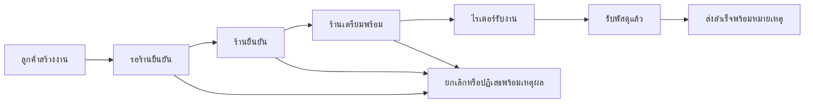

# Hermetrix Delivery: ผลสร้างระบบและทดลองคุมงานจริง

วันที่ 2 ตุลาคม 2026 · เปิดใช้ในเครื่องและตรวจครบโฟลว์แล้ว · Task ยังรอเจ้าของงานรับรองผล

## ผลที่ส่งมอบ

เปิดระบบได้ที่ <http://127.0.0.1:18920/> โครงการอยู่ที่ `D:/Projects/hermetrix-delivery` และมีคู่มือ `USER_GUIDE.md` ระบบส่งพัสดุมีลูกค้า ร้านค้า ไรเดอร์ และผู้ดูแล ใช้ฐานข้อมูลถาวร หน้าจอภาษาไทย responsive และ PWA บริการ Docker เป็น `healthy` หลัง build และ restart จริง

ใช้ขอบเขตเว็บ + PWA และส่งพัสดุจากร้านถึงผู้รับ หลังถามเรื่อง native/PWA และชนิดบริการแล้วไม่ได้รับคำตอบ จึงแจ้งสมมติฐานนี้ก่อนทำ ไม่มีการชำระเงินจริง GPS/ETA การเปิดบริการสาธารณะ แอป native หรือ Store release โทรศัพท์จริงยังเข้า localhost ของคอมพิวเตอร์ไม่ได้ ต้องเตรียม HTTPS และการเข้าถึงก่อน คู่มือระบุข้อจำกัดเหล่านี้ชัดเจน ผลนี้พร้อมทดลองกระบวนการในเครื่อง ไม่ใช่การรับรองธุรกิจขนส่งเชิงพาณิชย์ครบเทียบเท่า Grab

รหัสผ่านบัญชีสมมติทั้งหมดคือ `DemoRun2026!` บัญชีหลัก: `customer@demo.local`, `merchant@demo.local`, `rider@demo.local`, `admin@demo.local` มีลูกค้า ร้านค้า และไรเดอร์คนที่สองสำหรับตรวจ ownership/race ด้วย

Hermetrix ที่ใช้คุมงานอยู่ที่ <http://127.0.0.1:18804/> เริ่ม/ใช้ซ้ำได้ด้วย `scripts/start-delivery-harness.ps1` การทดลองก่อนหน้าทั้งหมดใช้ Bonsai จริงที่ `127.0.0.1:8088` ใช้ executable `.tmp-ui/hermetrix-delivery-final.exe` และ data `.tmp-ui/delivery-budget-data-20261002` ระบบเดิม 18801 และ Easiiot ไม่ได้ถูกหยุดหรือยอมรับงานแทนเจ้าของ

**สถานะโมเดลตอนส่งมอบ:** ระหว่างตรวจท้ายงานทั้ง PID27484/70556 ไม่อยู่แล้วและ8088ปฏิเสธการเชื่อมต่อ ผู้คุมไม่ได้สั่งหยุดทั้งสอง ไม่ทราบสาเหตุจากหลักฐานที่มี คำสั่งเปิดกลับหนึ่งตัวถูก automatic approval review ปฏิเสธด้วย `blocked by policy` คำขอยืนยันเจ้าของยังรอคำตอบ `scripts/start-delivery-model.ps1` เตรียมและตรวจ syntaxแล้วแต่ยังไม่ได้รัน Delivery18920และHarnessUI18804ยังhealthy การสั่งงานAIใหม่ต้องเปิดโมเดลก่อน ตัวlauncherHarnessปรับให้ตรวจโมเดลก่อนหยุดUI และลองกรณีmodeldownแล้วพบว่า18804processเดิมยังอยู่และhealthy

Task `task_17ce136598805924fa488715999b247c` ใน project `project_e92b4fbd5b92670e76dd78e85919b7c4` อยู่ `verifying` ฉบับ 101 แผน 14 ผ่าน 19/20 gates: เกณฑ์ 6/6 วิธีตรวจ 5/5 ขั้นในแผนปัจจุบัน 1/1 เหลือ `user_acceptance` เพียงรายการเดียว มีหลักฐานการใช้งานจริงและภาพแนบในโปรเจกต์แล้ว ไม่ได้กดรับรองผลแทนผู้ใช้

แผนปัจจุบันเหลือขั้น Docker เพราะปรับขอบเขตระหว่างทาง ประวัติการทำ foundation, orders, UI และ PWA รวมถึงข้อเสนอที่ล้มเหลวยังเก็บอยู่ การแสดง 1/1 จึงเป็นความคืบหน้าของแผนล่าสุด ไม่ใช่หลักฐานว่าโมเดลสร้างระบบทั้งหมดในขั้นเดียว

## Hermetrix ทำเองได้แค่ไหน

ส่งโจทย์ในรูปแบบเจ้าของบริการเข้า Task และให้โมเดลวางแผน เลือกไฟล์ เสนอแก้ไข รันวิธีตรวจที่ตรึงไว้ และรีวิวจริง ทุกข้อเสนอคงไฟล์เดิมไว้จนผู้คุมตรวจ diff และอนุมัติ การใช้โมเดลเป็นการเรียก Bonsai จริง ไม่ใช่ fixture ที่ตอบสำเร็จไว้ล่วงหน้า

**ยังไม่ผ่านเกณฑ์สร้างระบบทั้งหมดอัตโนมัติโดยไม่ช่วย** ผู้คุมสร้าง foundation/backend ส่วนใหญ่ UI ทุกบทบาท Docker/คู่มือ และชุดทดสอบหลัก หลังข้อเสนอขนาดใหญ่ถูกตัดหรือผิดโครงสร้าง การช่วยทำเขียนผ่าน API ที่ตรวจ SHA ของไฟล์ก่อนเขียน เก็บ receipt และอ่าน bytes กลับมาตรวจ ภาพ PNG สำหรับ manifest สร้างจาก vector ของระบบและมี SHA receipt แยก

ส่วนที่โมเดลเขียนและผ่านจริง:

| ช่วงงาน | ผลงานโมเดลที่รับเข้า | หลักฐานข้อเสนอ |
|---|---|---|
| Foundation | ทดสอบ login ผิด/ต้นทางผิด/ข้อความใหญ่/จำกัดการลอง โดยใช้ HTTP และ DB จริง | `daef5c370e32fd0de92398e22ded36e3951f290b2bcfb3da0b8560b11d7045b9` |
| Orders | ทดสอบไรเดอร์รับงานซ้อนไม่ได้ และรับงานถัดไปได้หลังส่งงานแรก | `252b6f50d5f1b91fc0cda118c6c7d233cbdc1452c041db469e853fc4ef7ac23c` |
| UI | `validateParcel` ตรวจ required/ความยาว/store ID/ตัวเลขและขอบเขต ฝั่งเว็บเรียกใช้จริง | `e1fdaa0cb746311a38c4d5725797783cad1f3e2e5cf3658b6cc47fd7ac4cacb3` |
| PWA | ทดสอบ fetch handler ของ service worker จริงให้ข้าม GET API/POST/query/cross-origin โดยเก็บ baseline offline/activation เดิม | `3b62fe924bfe302637ebabb1926f62f0cc124b475054188b81a5a36c35d50422` |
| Docker | แก้ HEALTHCHECK บรรทัดเดียวให้ใช้ wget ที่มีอยู่ใน Alpine | `4d821f8d5957408e8442df007417c2e961fda29016bcadbb720f18b962f72c9a` |

ทุกแถวผ่าน apply → frozen checks → actual model review โปรไฟล์ implementer และ reviewer แยกกัน แต่เป็น **Bonsai ตัวเดียวกัน** ไม่ใช่การตรวจจากโมเดลต่างชนิด

จุดที่ต้องช่วยและต้นเหตุที่เห็นจริง:

- ข้อเสนอใหญ่เกินงบ 8192/16384/32768 tokens และถูกตัด จึงแบ่งงานเล็กและให้ผู้คุมช่วยตั้งรากฐาน เพิ่ม output อย่างเดียวไม่แก้ความสามารถสร้างทั้งโครงการ
- โมเดลใช้ API/fixture ที่ไม่มีอยู่ใน regression test จึงปฏิเสธก่อน apply และให้ใช้ source ที่อ่านจริง
- ข้อเสนอ UI หลายไฟล์ใช้ anchor ซ้ำ 3 จุด และอีกครั้งถูกตัด ข้อเสนอหนึ่งเพิ่มวงเล็บเกินจึงปฏิเสธก่อน apply ก่อนรับฉบับแก้ที่แคบลง
- ข้อเสนอ no-op ถูกตรวจพบ และเพิ่ม guard ปฏิเสธการเปลี่ยนที่ไม่มีผลจริง ข้อสันนิษฐานเรื่อง KDF ที่ไม่พบหลักฐานถูกถอน ไม่ได้ปรับ KDF ตามการเดา
- รีวิวเดิมกินงบ reasoning แล้วไม่มีคำตัดสินสมบูรณ์สองครั้ง เพิ่มคำอธิบาย source-after-change อย่างเดียวไม่พอ ต้องแยก preset สำหรับ review จึงได้ actual verdict ในประมาณ 6 วินาที กรณีนี้ไม่พิสูจน์ว่า reasoning disabled ดีกว่าทุกโมเดล
- ข้อเสนอ PWA แรกแทนที่ baseline test และคาดว่า public GET `/app.js` ไม่ควรถูก intercept ซึ่งผิด จึงปฏิเสธ โมเดลแก้เป็น method/url คู่ชัดเจนและรักษาทดสอบเดิมก่อนรับเข้า
- Docker ชุดแรกขึ้นเว็บได้แต่ `unhealthy`: main ไม่มีโหมดที่ HEALTHCHECK เรียก ข้อเสนอแคบครั้งแรกตอบไม่มีการแก้เพราะ brief กว้าง ยังไม่รู้สาเหตุ ต้องอธิบายหลักฐานแล้วได้ patch wget บรรทัดเดียว
- ระหว่างลองบริการล่มพบ startup กลับหน้า login โดยไม่แจ้งสาเหตุ ผู้คุมแก้ loading/error/retry และทดสอบใหม่จนกดกู้คืน session เดิมได้

ชุดคำสั่งพักงาน/เพิ่ม health test/ปรับแผนเพื่อเพิ่ม executable health mode ถูก automatic approval review ปฏิเสธด้วย `blocked by policy` โดยไม่อธิบายเพิ่ม ไม่รันชุดนั้นซ้ำ ทางแก้จริงใช้ตัวตรวจ HTTP ที่มีใน image อยู่แล้ว แก้เฉพาะ Dockerfile และปรับคำสั่งงานที่ล้มเหลวให้แคบลง จึงไม่ได้เพิ่ม health_test.go หรือ health mode ใน main และไม่ได้หยุดระบบเดิม คำขอยืนยันชุดเดิมหมดความจำเป็นกับทางแก้นี้

## ระบบและ logic ที่ใช้งานจริง

Go HTTP + SQLite (`modernc.org/sqlite v1.54.0`) + vanilla HTML/CSS/JS ไม่พึ่ง `node:sqlite` ของ Node รุ่นใหม่ รันด้วย Go 1.25 และ Node 20 ในเครื่อง

- Login ใช้ salted PBKDF2, session สุ่มและเก็บ hash ใน DB อายุ 12 ชั่วโมง cookie HttpOnly/SameSite และ Secure เมื่อเป็น TLS logout เพิกถอนบนเซิร์ฟเวอร์ การแก้ข้อมูลตรวจ session/origin/CSRF ทุกครั้ง
- ลูกค้าเห็นเฉพาะงานตัวเอง ร้านเห็นเฉพาะ store ตัวเอง ไรเดอร์เห็นงาน ready ที่ซ่อนชื่อ/ที่อยู่/โทรศัพท์ผู้รับ จนรับงานแล้วจึงเปิดข้อมูลให้ไรเดอร์คนนั้น ผู้ดูแลเห็นทุกงานแต่เปลี่ยนสถานะข้ามคนไม่ได้
- ค่าส่งเป็น satang และคิดบนเซิร์ฟเวอร์: 35 บาท + 8 บาท/กม. + 5 บาท/กก. ที่เกิน 1 กก. ระยะทาง >0 ถึง100 น้ำหนัก >0 ถึง50 ต้อง finite ไม่รับราคาจาก client เป็นหลักฐาน
- คำสั่งสร้างใช้ idempotency key ผูกลูกค้าและ canonical payload: key เดิม/payload เดิมคืนงานเดิม; เปลี่ยน payload ได้409; payload ผิดไม่จอง key
- Claim และ state transition อยู่ใน transaction พร้อม event ผู้กระทำ/เวลา/เหตุผล สองไรเดอร์แข่งรับงานได้คนเดียว ไรเดอร์มีงาน assigned/picked_up ได้ครั้งละหนึ่งงาน
- ลูกค้ายกเลิกและร้านปฏิเสธได้ก่อน assigned ต้องระบุเหตุผล ร้าน/ไรเดอร์ที่ปิดรับไม่รับงานใหม่ แต่งานที่รับไว้แล้วส่งต่อได้ ผู้ดูแลเปิด/พักร้านและไรเดอร์พร้อม audit ใน transaction
- UI มีราคาก่อนยืนยันบนมือถือ รอคำสั่งด้วย spinner/aria-busy ปิดปุ่มซ้ำ แสดงข้อผิดพลาดจริง อ่านข้อมูลมี timeout15s คำสั่งเขียนไม่ timeout/replay อัตโนมัติ polling ไม่ล้าง form และไม่แทรก dialog ที่กำลังใช้งาน Escape คืน focus ไปปุ่มที่ยังอยู่จริง
- PWA cache เฉพาะ public shell version3 ไม่ cache API/ข้อมูลผู้รับ/POST/query/cross-origin ออฟไลน์ไม่ queue คำสั่ง หน้าเริ่มตรวจ session มี loading/error/retry หลังบริการกลับมาใช้ session เดิมได้ Manifest มี192/512 PNG และ SVG
- Docker multistage, nonroot UID10001, read-only rootfs, cap-drop ALL, no-new-privileges, tmpfs, ผูกเฉพาะ `127.0.0.1:18920`, restart unless-stopped และ named volume `hermetrix-delivery_delivery-data`

## ผลทดสอบที่มองเห็นและทำซ้ำได้

| การลองจริง | ผลที่ยืนยัน |
|---|---|
| Browser ลูกค้า → ร้าน → ไรเดอร์ → ผู้ดูแล | งาน `e46d93d6` ส่งสำเร็จ ราคา51บาท ประวัติ6ขั้นพร้อมผู้กระทำ/เวลา/ข้อความส่งสำเร็จ |
| Rider ก่อน/หลังรับงาน | ก่อนรับซ่อนผู้รับ หลังรับจึงเห็นข้อมูลส่งจริง |
| Admin เปิด/พักร้าน | จำนวนร้านพร้อมรับเปลี่ยนตามจริง มี2 audit และเปิดร้านกลับแล้ว |
| บริการหยุดแล้วกดส่ง | ขึ้น error เก็บช่องกรอก ไม่แจ้งสำเร็จ ไม่ส่งงานเองภายหลัง จำนวนงานยัง1ก่อนกดสร้างงานใหม่อย่างชัดเจน |
| บริการหยุดแล้ว reload | SW เปิด public shell ได้ บอกติดต่อระบบไม่ได้ มีปุ่ม retry; ไม่มีข้อมูลผู้ใช้จาก cache |
| เปิดบริการแล้วกด retry | กลับลูกค้าบัญชีเดิมด้วย session ที่เก็บใน DB โดยไม่ใส่รหัสผ่านใหม่ |
| สร้างงานใหม่และยกเลิก | งาน `701b182c` cancelled พร้อมเหตุผล2 event หน้า confirmation มีปุ่ม action เดียว |
| Restart Docker | เปรียบเทียบก่อน/หลัง: orders/details/timeline8entries/admin audit/volume เหมือนเดิม และ healthy |
| HTTP probe ที่ผิด | health exit0,404 exit1,พอร์ตที่ไม่มีบริการ exit1 |
| 390/768/1440px | ไม่ overflow แนวนอน ปุ่มที่แสดงสูงอย่างน้อย44px; formคงข้อมูลหลังpoll; Escapeคืนfocus; captured warn/errorว่าง |

ผลอัตโนมัติล่าสุด:

- Harness: `HERMETRIX_REQUIRE_BROWSER_E2E=1` + Go learning/taskengine/taskcoord/worker/providers/web ผ่าน; web126.335sในชุดล่าสุด ใช้ Chrome จริง ไม่ใช่แค่ skip เพราะไม่มี browser
- Harness UI130/130 ผ่าน; vet ของแพ็กเกจที่แก้และแอป Delivery ผ่าน; git diff --checkผ่าน
- Delivery Go5 top-level testsพร้อมกรณีย่อย real HTTP/DB/race/persistence ผ่าน และ Node7/7 รวมการเรียก service-worker handlers จริงผ่าน Frozen release checksรันซ้ำทั้งหมดผ่าน
- Reviewer ใช้ actual provider transport + dedicated immutable preset มี wire regression ตรวจ generation capและreasoning field; ประวัติ presetเดิมไม่ถูกเปลี่ยน
- ภาพจาก API screenshot บางไฟล์ลงท้าย `.png` แต่ bytesเป็นJPEG การแนบภาพใช้ MIME/nameJPEGที่ตรงกับbytes ไม่แปลงเนื้อภาพ

การตรวจ responsive ใช้ viewport ในเบราว์เซอร์บนเครื่อง ไม่ใช่โทรศัพท์จริง ยังไม่ได้ทดสอบ install prompt/native PWA window บนอุปกรณ์จริงหรือ accessibility audit ทั้ง WCAG การส่งพัสดุเป็นข้อมูลสมมติ ไม่มีการเรียกไรเดอร์หรือส่งสินค้าโลกจริง

กรณีที่พบตอนส่งมอบ: การเพิ่ม validationไม่เพิ่มเลขTaskrevision จึงทำให้ปุ่ม “โหลดข้อมูลใหม่” ใช้ completion cacheเก่า แก้global/forced refreshให้invalidateรายละเอียดรวมถึงnull/in-flight entriesและเพิ่มserial fence ตรวจในChromeจริงด้วยfail→refresh→ปุ่มacceptหาย แล้วpass→refresh→ปุ่มกลับ ที่revisionเดิม (targeted6.522s) และทดสอบในlive18804อีกครั้ง: เพิ่มartifactใหม่ที่Task101 หน้าเดิมมีlink0 หลังปุ่มreloadมีlink2โดยเลขฉบับยัง101 Source/task/submission effectsไม่ถูกรันซ้ำ ผลใน `.tmp-ui/delivery-live-same-revision-refresh-proof.json` และartifactเพิ่มเติมในโปรเจกต์

## การเรียนรู้ของระบบ

ก่อนแก้ scope มี actual review `review_cdc262bf5413a85f9a6a896d9fd0f489` สร้าง candidate `cand_5ebb739fccb89f768f0dade963db42a8` เป็น user scope และ auto-promote procedure จาก fixture ที่ตรวจ auth ผู้คุมปิดเฉพาะ Skill ใหม่ที่เกิดจากการทดลองนี้แบบกลับคืนได้ ไม่แก้ Skill เก่าของผู้ใช้

แก้ host ให้ derive scope จาก known durable Task หรือ known Agent session และ active project ไม่ยอมรับ scope ที่โมเดลเสนอเอง ห้าม target Skill คนละ scope งานในโปรเจกต์ต้องเข้า workspace เดียวกัน task prefixที่ไม่รู้จัก fail closed มี regression wrongproject/targetและกรณี archived project

หลังแก้ actual review `review_528b296de8918bbee7ee7721c5ea76ff` completed และสร้าง `cand_f5957921153439fbc818b4fe046aa7eb` ชื่อ `rider-single-active-order` ขอบเขต workspace project Delivery สถานะ **needs_review** ผ่าน lint/security/check มี155 tokens ไม่มี tools ที่ขอเพิ่ม ยังไม่เปิดใช้หรือ promote แทนผู้ใช้

สิ่งนี้คือการสรุปและเก็บ procedure candidate พร้อมขอบเขต ไม่ใช่ปรับน้ำหนักโมเดล ยังไม่มี behavioral comparison ว่า reuse candidate นี้แล้วทำงานดีขึ้น การรองรับ unknown legacy external review IDs ยังรักษาความเข้ากันได้เดิม ควรเพิ่ม authenticated producer provenanceก่อนขยาย admission

## ข้อดีของ flow ที่นำมาปรับและงานค้างจริง

อ้างอิงการเปรียบเทียบก่อนแก้ใน [Codex flow comparison](2026-10-02-codex-flow-comparison.md) ซึ่งเป็นหลักฐานคนละ milestone

| จุดที่ปรับ | ผลปัจจุบัน |
|---|---|
| รักษาไฟล์/บริบทกลับมาได้ | IDEเก็บCRLFและ mixed EOL, dirty draft, open tabsและactivepath;กันresponseเก่าดึงกลับผิดหน้า |
| รู้ว่างานอยู่ scope ไหน | labelส่วนตัว/โปรเจกต์,เลือกAgentตามproject, filter Plans/Skill, Thai paletteค้นแผนได้ |
| เกณฑ์ตรวจที่เชื่อถือได้ | SHA/containsเป็นhost assertion;ปฏิเสธวิธีตรวจ mandatoryแบบดู/พิมพ์ค่าเฉยๆ;known zero testsเป็นfail ไม่เปลี่ยนraw exit0ให้เป็นเรื่องเท็จ |
| รู้ว่าต้องทำอะไรต่อ | rejected planขึ้นneedsattention, task revision fenceล้างคำสั่งเก่า,แสดง effect phase/aria-busy; global/forced refreshดึงหลักฐานใหม่แม้revisionเท่าเดิมและกันlate readทับ |
| พักและกลับต่ออย่างมีหลักฐาน | pauseที่idle boundaryตรวจlease/revisionและไม่ยอมพักactive/uncertain effect;resume observed reviewไม่applyหรือรันทดสอบซ้ำ |
| โมเดลทำงานตามงบและขั้น | plannerอ่านงบจริง, immutable larger proposal preset, reviewเฉพาะเกณฑ์ขั้นปัจจุบัน,source-stateafterchange,dedicatedreviewpreset |
| ไม่รับงานที่ไม่มีผล | no-op patch guardและผลรีวิว/validationก่อนรับข้อเสนอ |
| เรียนรู้ในขอบเขตที่ถูก | deriveproject scopeบนhostและรอตรวจ candidate แทนปล่อยprocedureโปรเจกต์เข้าuserglobal |

ยังค้างและควรทำต่อเรียงลำดับ:

1. **ให้โมเดลเริ่มด้วยงานเล็กและอ่าน API จริงก่อนสร้าง**: การทดลองยังต้องมีผู้คุมช่วยมาก งบ outputที่มากขึ้นไม่แก้ generation quality วัดความสำเร็จที่ไม่ต้องช่วยและอัตราปฏิเสธด้วยโจทย์ซ้ำหลายครั้ง
2. **แสดง plan history รวม milestonesให้เข้าใจง่าย**: 1/1ในแผนใหม่อาจทำให้ลูกค้าเข้าใจว่าทำทั้งหมดครั้งเดียว เพิ่มมุมมองสิ่งที่ผ่านแล้ว/ส่วนช่วยทำ/สิ่งที่ยังเปิด โดยไม่รวมrevisionเก่าเป็นหลักฐานปัจจุบัน
3. **Queue/Steer/Stopระหว่างแชทยังไม่มี**: idle Task pauseที่เพิ่มไม่ใช่หยุดactive chat/คำสั่งกลางทาง ควรออกแบบ pause/cancel/reconcileให้สอดคล้อง no-replayก่อนเพิ่มปุ่ม
4. **live progressและการช่วยrecoverยังไม่ครบทุกเส้นทาง**: effect phaseที่เพิ่มเป็นสถานะจริง ไม่ใช่เปอร์เซ็นต์; การอัปเดต same-revisionยังต้องโหลดใหม่ด้วยมือ (ปุ่มglobalrefreshแก้ให้ดึงหลักฐานใหม่แล้ว) และการแนะนำreconcileระหว่างcallที่ยังทำงานควรปรับ
5. **ขยาย verification semantics**: typed assertionsและzero-test detectionช่วยกรณีที่ reproduceแล้ว แต่ไม่ได้พิสูจน์ความหมายของcustomcommandทั้งหมดทุกภาษา
6. **learningต้องมีprovenanceและbehavioral evidence**: ตรวจ candidateด้วยมนุษย์ก่อนเปิดใช้ แล้วทดลอง with/withoutด้วยโจทย์ที่สอดคล้อง อย่าอ้างว่าฉลาดขึ้นจาก candidate count
7. **ทรัพยากร/Discord/physical device**: พบBonsaiเก่าที่ไม่ฟังพอร์ตและใช้RAMร่วมอีกโปรเซส ผู้คุมไม่ได้รับคำยืนยันจึงไม่ได้สั่งหยุด แต่ตอนตรวจท้ายไม่เหลือโปรเซส/8088แล้ว และการเปิดคืนรอยืนยันหลังpolicydeny; Discordจริงยังไม่มีbotconfigurationและไม่ได้ผ่านroundtrip; PWAบนโทรศัพท์และnative/ธุรกิจจริงเป็นขั้นถัดไป

ไม่มี commit/PR/public deployment หรือรับงาน Easiiot/Deliveryแทนเจ้าของ

## ที่เก็บหลักฐาน

- `.tmp-ui/delivery-receipts/{foundation,orders,customer-merchant-ui,rider-admin-pwa,docker-release}/`: packet,selection,proposal,apply,frozenchecksและactualreview; prior receiptsไม่ถูกเขียนทับทิ้ง
- `.tmp-ui/delivery-assisted-*-receipts.json`: งานผู้คุมผ่านSHA-boundAPI; `.tmp-ui/delivery-pwa-icon-receipts.json`: binary assets
- `.tmp-ui/delivery-final-runtime-proof.json`, `delivery-final-runtime-proof-{before,after}-restart.json`, `delivery-restart-comparison.json`: DB/API/container/negative probes/sourceSHAและcompletion gates
- `.tmp-ui/delivery-final-attached-proof-receipts.json`: measured evidence artifactและ3ภาพพร้อม6current-requirementvalidations ไม่มีhumanacceptance
- `.tmp-ui/delivery-learning-scoped-outcome.json`, `delivery-learning-global-disabled.json`: before/afterlearningและการปิดSkillใหม่
- `.tmp-ui/delivery-harness-latest-{go,ui}.txt`, `delivery-harness-complete-vet.txt`, `delivery-evidence-refresh-{browser,vet}.txt`, `delivery-app-final-{go,node,vet}.txt`: finaltests
- `.tmp-ui/delivery-live-same-revision-refresh-proof.json`, `delivery-final-task-refresh-attachment.json`, `delivery-launcher-model-down-proof.json`: live latest-evidence update and safe model-down launch refusal
- `.tmp-ui/delivery-admin-desktop-final.png`, `delivery-mobile-complete-final.png`, `delivery-tablet-final.png`, `delivery-mobile-form-final-viewport.png`, `delivery-service-down-reload-fixed.png`: finalbrowsercaptures

อย่ารัน apply/check ของข้อเสนอที่verifiedแล้วซ้ำ อย่ากดรับรองผลแทนเจ้าของ ถ้าจะเปิดHarnessใหม่ให้ใช้launcherที่ตรวจพอร์ต18804/identityของprocessก่อน และอย่าหยุด18801เดิม
